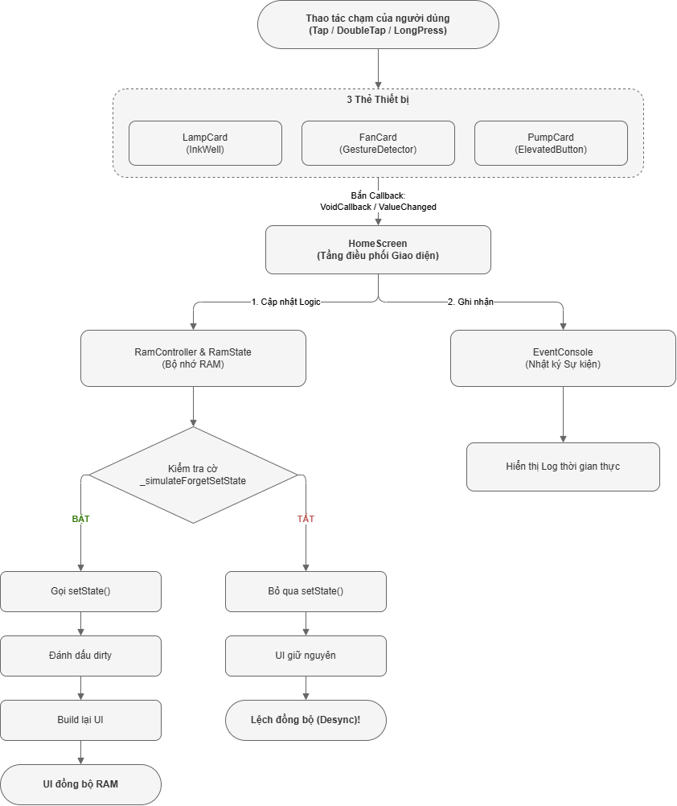

# BÁO CÁO CHUYÊN ĐỀ HỌC PHẦN LẬP TRÌNH ĐA NỀN TẢNG
# CHỦ ĐỀ 07: SỰ KIỆN VÀ TƯƠNG TÁC NGƯỜI DÙNG TRONG GIAO DIỆN (EVENT & STATE INTERACTION): XÂY DỰNG BẢNG ĐIỀU KHIỂN THIẾT BỊ, CƠ CHẾ CALLBACK, GESTUREDETECTOR, INKWELL VÀ ĐỐI CHIẾU TRẠNG THÁI RAM - UI QUA SETSTATE()

---

## 📌 THÔNG TIN CHUNG
* **Học phần:** Lập Trình Đa Nền Tảng (Cross-Platform Application Development)
* **Khoa:** Điện Tử và Trí Tuệ Nhân Tạo – Trường Đại học Bách Khoa, Đại học Đà Nẵng
* **Giảng viên hướng dẫn:** ThS. Nguyễn Duy Nhật Viễn
* **Nhóm sinh viên thực hiện:**
  1. **Lê Anh Khoa** – MSSV: **106230016** – Lớp: **23KTMT1** *(Trưởng nhóm - Quản trị GitHub, Kiến trúc Bộ nhớ RAM & State, ControlBar, EventConsole, Kiểm chứng setState(), Báo cáo & Slide XeLaTeX)*
  2. **Ngô Quang Thế** – MSSV: **106230028** – Lớp: **23KTMT1** *(Thành viên - Nghiên cứu Callback & GestureDetector vs InkWell, UI/UX Thiết bị Đèn & Quạt, Unit Test & Widget Test, Live Demo)*
* **Repository GitHub công khai:** [https://github.com/KhoaLe246205/cross-platform](https://github.com/KhoaLe246205/cross-platform)
* **Thư mục chuyên đề:** `event_interaction/`
* **Slide thuyết trình hoàn chỉnh (PDF 23 trang):** [`docs/slide_event_interaction.pdf`](docs/slide_event_interaction.pdf)
* **Mã nguồn slide thuyết trình (XeLaTeX):** [`docs/slide_event_interaction.tex`](docs/slide_event_interaction.tex)

---

## 📑 MỤC LỤC
1. [Giới thiệu chuyên đề & Mục tiêu nghiên cứu](#1-giới-thiệu-chuyên-đề--mục-tiêu-nghiên-cứu)
2. [Bản chất công nghệ & Sơ đồ kiến trúc (Deep Dive)](#2-bản-chất-công-nghệ--sơ-đồ-kiến-trúc-deep-dive)
3. [Cấu trúc mã nguồn dự án](#3-cấu-trúc-mã-nguồn-dự-án)
4. [Hướng dẫn cài đặt & Cấu hình môi trường](#4-hướng-dẫn-cài-đặt--cấu-hình-môi-trường)
5. [Phân chia công việc (Work Breakdown Structure - WBS)](#5-phân-chia-công-việc-work-breakdown-structure---wbs)
6. [Kịch bản thực nghiệm, Bảng ca kiểm thử Live Demo & Đánh giá hiệu quả](#6-kịch-bản-thực-nghiệm-bảng-ca-kiểm-thử-live-demo--đánh-giá-hiệu-quả)

---

## 1. GIỚI THIỆU CHUYÊN ĐỀ & MỤC TIÊU NGHIÊN CỨU

### 1.1. Bối cảnh thực tế
Trong phát triển ứng dụng di động và đa nền tảng hiện đại với Flutter, giao diện người dùng không thể chỉ là những khung hình tĩnh đơn thuần. Mọi trải nghiệm số đều bắt nguồn từ tương tác: người dùng chạm ngón tay vào màn hình cảm ứng, nhấp chuột, cuộn trang, hoặc gõ phím. Để phản hồi lại những hành vi này, hệ thống giao diện cần xử lý các luồng sự kiện (Event Handling) và cập nhật lại trạng thái hiển thị (State Management) một cách chính xác, nhanh chóng và mượt mà.

Tuy nhiên, trong quá trình lập trình thực tế, lập trình viên thường xuyên gặp phải những vấn đề kỹ thuật cốt lõi:
* **Sai lầm về truyền nhận hàm gọi lại (Callback Scope Misuse):** Nhầm lẫn giữa việc truyền tham chiếu hàm (`onPressed: _handleTap`) và lời gọi thực thi hàm ngay lập tức (`onPressed: _handleTap()`), gây ra lỗi kích hoạt logic ngay khi Widget vừa khởi dựng.
* **Lúng túng giữa `GestureDetector` và `InkWell`:** Không phân định được khi nào cần hiệu ứng phản hồi xúc giác gợn sóng nước (Material Ripple Effect) và khi nào cần nhận diện cử chỉ phức hợp (chạm đơn, chạm đúp, nhấn giữ). Nhiều trường hợp dùng `InkWell` bị lỗi mất hiệu ứng do thiếu ancestor `Material`, hoặc dùng `GestureDetector` nhưng bị trượt vùng chạm do chưa cấu hình `HitTestBehavior`.
* **Vô hiệu hóa điều khiển không an toàn:** Ép người dùng bấm nút nhưng dùng câu lệnh `if-else` trong hàm để chặn logic, thay vì vô hiệu hóa tự nhiên bằng cách gán `onPressed: null` – làm mất đi trạng thái thị giác chuẩn Material (nút mờ xám, không nhận con trỏ chuột).
* **Ngộ nhận về cơ chế `setState()`:** Lập trình viên thay đổi trực tiếp biến dữ liệu trong bộ nhớ RAM nhưng quên gọi `setState()`, khiến dữ liệu logic đã thay đổi nhưng cây Widget không nhận được tín hiệu đánh dấu cờ `dirty` để vẽ lại, dẫn đến hiện tượng **lệch đồng bộ nghiêm trọng giữa RAM và Giao diện (State Desynchronization)**.

### 1.2. Mục tiêu dự án
* **Làm chủ cơ chế Callback & First-Class Functions trong Dart:** Vận dụng linh hoạt các kiểu hàm chuẩn `VoidCallback`, `ValueChanged<T>`, và closure để chuyển tiếp sự kiện từ Widget con lên Widget cha mà không phá vỡ tính đóng gói.
* **So sánh và làm chủ công nghệ tương tác:** Phân tích chuyên sâu `InkWell` (hiệu ứng sóng nước Material) và `GestureDetector` (bắt 3 cử chỉ: `onTap`, `onDoubleTap`, `onLongPress` kết hợp `HitTestBehavior.opaque`).
* **Kiểm chứng cơ chế vô hiệu hóa (Disabled State):** Ứng dụng thuộc tính `onPressed: null` để khóa tự động các nút bấm toàn cục khi toàn bộ thiết bị đang ở trạng thái nghỉ.
* **Làm sáng tỏ bản chất chu trình `setState()` và nguyên lý phản ứng $UI = f(State)$:**
  * Giải mã chu trình từ lúc nhận Callback $\to$ cập nhật RAM $\to$ `markNeedsBuild()` $\to$ `Element.rebuild()` $\to$ vẽ lại khung hình (Paint).
  * Xây dựng công tắc mô phỏng tình huống quên `setState()` để chứng minh hiện tượng dữ liệu trong RAM đã thay đổi nhưng UI bị đóng băng không đổi.
* **Xây dựng ứng dụng thực nghiệm Bảng điều khiển thiết bị (Event & State Interaction Lab):** Trực quan hóa đường ống xử lý 4 bước, tích hợp bảng nhật ký sự kiện thời gian thực (Event Console) và bảng đối chiếu RAM - UI trực tiếp trên màn hình.

---

## 2. BẢN CHẤT CÔNG NGHỆ & SƠ ĐỒ KIẾN TRÚC (DEEP DIVE)

### 2.1. Cơ chế Callback & First-Class Functions trong Dart
Trong ngôn ngữ Dart, hàm được coi là **công dân hạng nhất (First-Class Citizens)**. Điều này đồng nghĩa với việc:
1. Hàm có thể được gán vào biến như một giá trị thông thường.
2. Hàm có thể được truyền làm đối số (argument) cho một hàm hoặc constructor khác.
3. Hàm có thể được trả về từ một hàm khác.
4. Hàm có thể được tạo ẩn danh (Anonymous Functions / Lambdas / Closures) và lưu giữ ngữ cảnh bao bọc (Lexical Scope).

#### 2.1.1. Các định dạng Callback chuẩn trong Flutter
* **`VoidCallback`:** Kiểu hàm không nhận tham số và không trả về giá trị:
  ```dart
  typedef VoidCallback = void Function();
  ```
  Thường dùng cho các tương tác chạm đơn giản: `onTap`, `onPressed`, `onLongPress`.
* **`ValueChanged<T>`:** Kiểu hàm nhận đúng 1 tham số kiểu `T` và không trả về giá trị:
  ```dart
  typedef ValueChanged<T> = void Function(T value);
  ```
  Thường dùng khi tương tác tạo ra giá trị mới: `Switch.onChanged(bool value)`, `Slider.onChanged(double value)`.

#### 2.1.2. Phân biệt Truyền tham chiếu hàm vs Thực thi hàm ngay lập tức
Một lỗi phổ biến của người mới bắt đầu:
```dart
// SAI: Thực thi hàm ngay lúc build cây Widget, gán giá trị trả về (void) cho onPressed
ElevatedButton(
  onPressed: _handleToggle(), // Lỗi logic: hàm chạy ngay khi vẽ giao diện!
  child: const Text('Bật/Tắt'),
)

// ĐÚNG: Truyền tham chiếu hàm (Tear-off / Callback Reference)
ElevatedButton(
  onPressed: _handleToggle, // Chỉ thực thi khi người dùng click vào nút
  child: const Text('Bật/Tắt'),
)

// ĐÚNG: Dùng Closure khi cần truyền đối số cụ thể
ElevatedButton(
  onPressed: () => _updateSpeed(2), // Hàm ẩn danh bao bọc tham số
  child: const Text('Cấp 2'),
)
```

---

### 2.2. Phân tích các thuộc tính tương tác: `onPressed`, `onTap` và cơ chế vô hiệu hóa an toàn

#### 2.2.1. Cơ chế kích hoạt và trạng thái Disabled
Trong các Button Widget chuẩn Material (như `ElevatedButton`, `TextButton`, `OutlinedButton`, `IconButton`):
* Thuộc tính tiếp nhận tương tác chính là `onPressed`.
* Khi `onPressed != null`: Nút ở trạng thái **kích hoạt (Enabled)**, lắng nghe sự kiện nhấp chuột / chạm, phản hồi hiệu ứng hover, focus, và splash.
* Khi `onPressed == null`: Flutter tự động chuyển Widget sang trạng thái **vô hiệu hóa (Disabled)**:
  - Màu nền và màu chữ tự động giảm độ tương phản (chuyển sang màu xám mờ).
  - Vô hiệu hóa toàn bộ Event Listener: không còn phản hồi sự kiện click, không hover, không splash.
  - Thay đổi con trỏ chuột trên Desktop sang dạng mặc định (thay vì con trỏ bàn tay).

```dart
// Khóa nút "Tắt tất cả" khi không có thiết bị nào đang bật
ElevatedButton.icon(
  onPressed: hasAnyDeviceActive ? _turnOffAllDevices : null,
  icon: const Icon(Icons.power_settings_new),
  label: const Text('Tắt tất cả'),
)
```

---

### 2.3. So sánh chuyên sâu: `GestureDetector` vs `InkWell`

| Tiêu chí so sánh | `GestureDetector` | `InkWell` |
|:---|:---|:---|
| **Bản chất tầng kiến trúc** | Tầng Widget cấp thấp (`widgets` layer), tương tác trực tiếp với `RawGestureDetector` và các `GestureRecognizer`. | Tầng Material Design (`material` layer), dẫn xuất từ `InkResponse`. |
| **Phản hồi thị giác** | **Không có hiệu ứng thị giác mặc định**. Chỉ lắng nghe sự kiện cử chỉ thuần túy. | **Có hiệu ứng sóng nước Material Ripple** lan tỏa từ tâm chạm kèm hiệu ứng đổ màu Highlight. |
| **Phụ thuộc môi trường** | Độc lập hoàn toàn, có thể dùng ở bất kỳ vị trí nào trên cây Widget. | **Bắt buộc phải có `Material` Widget làm tổ tiên (Ancestor)** để vẽ canvas hiệu ứng ripple. |
| **Độ đa dạng cử chỉ** | **Rất đa dạng (Multi-gestures):** Hỗ trợ `onTap`, `onDoubleTap`, `onLongPress`, `onPanStart/Update/End`, `onScale`, `onVerticalDrag`... | Giới hạn ở các cử chỉ chạm cơ bản: `onTap`, `onDoubleTap`, `onLongPress`, `onHighlightChanged`, `onHover`. |
| **Xử lý xuyên thấu vùng chạm** | Cung cấp thuộc tính `HitTestBehavior`: `deferToChild`, `opaque`, `translucent`. | Luôn bắt sự kiện trong phạm vi bao bọc hình học của vùng Material. |
| **Tình huống sử dụng tối ưu** | Các tương tác tùy biến phức tạp: cánh quạt xoay, canvas vẽ tự do, kéo thả game, thao tác vuốt trang. | Các thành phần giao diện chuẩn phong cách thẻ (Cards), danh sách (ListTiles), nút bấm có phản hồi chạm trực quan. |

#### Vai trò của `HitTestBehavior` trong `GestureDetector`
* `HitTestBehavior.deferToChild` (Mặc định): Chỉ các vùng có Widget con thực sự (chữ, icon) mới nhận được sự kiện chạm; các khoảng trống thừa (whitespace / padding rỗng) sẽ bỏ qua sự kiện.
* `HitTestBehavior.opaque`: Toàn bộ diện tích bao bọc hình học của Widget (kể cả vùng trống rỗng) đều hấp thụ sự kiện chạm và ngăn không cho sự kiện lọt xuống tầng dưới.
* `HitTestBehavior.translucent`: Cho phép cả Widget này lẫn các Widget nằm phía sau nó cùng nhận được sự kiện chạm.

Trong dự án thực nghiệm, thẻ Quạt thông gió sử dụng `HitTestBehavior.opaque` để người dùng có thể chạm, chạm đúp hoặc nhấn giữ ở bất kỳ điểm nào trên bề mặt thẻ mà không sợ hụt sự kiện.

```dart
GestureDetector(
  behavior: HitTestBehavior.opaque,
  onTap: widget.onTap,             // Chạm đơn: Bật/Tắt quạt
  onDoubleTap: widget.onDoubleTap, // Chạm đúp: Chuyển cấp gió 1 -> 2 -> 3 -> 1
  onLongPress: widget.onLongPress, // Nhấn giữ: Đặt lại nhanh về cấp 1
  child: ...,
)
```

---

### 2.4. Bản chất chu trình `setState()` và nguyên lý phản ứng $UI = f(State)$

#### 2.4.1. Nguyên lý giao diện khai báo (Declarative UI)
Trong Flutter, giao diện không được thao tác trực tiếp theo kiểu mệnh lệnh (*Imperative* - như `button.setText("ON")`). Thay vào đó:
$$UI = f(State)$$
Giao diện người dùng ($UI$) thuần túy là hàm biến đổi của Trạng thái ($State$). Khi Trạng thái thay đổi, hệ thống sẽ tính toán lại hàm $f$ để dựng lại giao diện tương ứng.

#### 2.4.2. Chu trình xử lý bên dưới của `setState()`
Khi lập trình viên gọi `setState((){ ... })`:
1. **Thực thi closure đồng bộ:** Hàm truyền vào `setState` được thực thi ngay lập tức để cập nhật giá trị biến trạng thái trong bộ nhớ RAM.
2. **Đánh dấu phần tử bị bẩn (`markNeedsBuild`):** Đối tượng `StatefulElement` gắn liền với `State` sẽ tự đánh dấu cờ `_dirty = true` và ghi danh vào danh sách các phần tử cần tái dựng của `BuildOwner`.
3. **Lập lịch khung hình (`scheduleFrame`):** Hệ thống Flutter Engine yêu cầu bộ lập lịch Window gửi tín hiệu VSync tiếp theo.
4. **Tái dựng cây Widget (`Element.rebuild()`):** Ở khung hình tiếp theo, framework duyệt qua các phần tử mang cờ `dirty`, gọi lại hàm `build()` của chúng để tạo ra cây Widget con mới.
5. **Cập nhật cây Render Object (`diffing & update`):** Framework so sánh cây Widget mới với cây Render Object hiện tại, chỉ thay đổi các thông số cần thiết (Render, Layout, Paint) mà không cần tạo lại các đối tượng phần cứng tốn kém.

#### 2.4.3. Hậu quả khi thiếu `setState()`: Lệch pha giữa RAM và UI
Nếu biến dữ liệu trong RAM được thay đổi nhưng không thông qua `setState()`:
* Dữ liệu logic trong RAM đã mang giá trị mới (ví dụ: `lamp.isOn = true`).
* Tuy nhiên, `StatefulElement` **không** được đánh dấu cờ `dirty`.
* Hàm `build()` **không** bao giờ được gọi lại.
* Cây Widget và màn hình hiển thị tiếp tục giữ trạng thái cũ ($\to$ Đèn vẫn tắt trên màn hình).

Trong chuyên đề này, nhóm đã thiết kế công tắc thực nghiệm `setState: Off / On` để chứng minh hiện tượng này một cách trực quan trên bảng đối chiếu `StateComparison`.

---

### 2.5. Sơ đồ kiến trúc & Luồng dữ liệu (Architecture & Data Flow)

<p align="center">
  
  <br>
  <em>Hình 2.1: Sơ đồ luồng phát tán sự kiện Callback, xử lý logic RAM và phân nhánh kiểm chứng đồng bộ qua setState()</em>
</p>

---

## 3. CẤU TRÚC MÃ NGUỒN DỰ ÁN

```text
event_interaction/
├── assets/
│   └── images/
│       └── event_architecture.png # Sơ đồ luồng phát tán sự kiện, xử lý RAM và kiểm chứng setState
├── docs/                          # Thư mục hồ sơ báo cáo & slide thuyết trình
│   ├── slide_event_interaction.pdf # File PDF Slide hoàn chỉnh đã biên dịch (23 trang)
│   └── slide_event_interaction.tex # Mã nguồn Slide thuyết trình Beamer XeLaTeX 23 trang
├── lib/                           # Toàn bộ mã nguồn ứng dụng Dart / Flutter
│   ├── main.dart                  # Điểm khởi nhập (Entrypoint), MaterialApp, Theme M3
│   ├── data/
│   │   └── sample_devices.dart    # Dữ liệu khởi tạo mặc định 3 thiết bị Smart Home
│   ├── models/
│   │   ├── device_model.dart      # Thực thể dữ liệu thiết bị, kiểu thiết bị, hành vi tương tác
│   │   ├── event_log.dart         # Cấu trúc bản ghi nhật ký sự kiện tương tác thời gian thực
│   │   └── ram_state.dart         # Bộ nhớ RAM lưu trữ trạng thái logic tách biệt cây giao diện
│   ├── views/
│   │   └── home_screen.dart       # Màn hình giao diện chính điều phối luồng sự kiện và setState
│   └── widgets/
│       ├── control_bar.dart       # Thanh công cụ: [Bật tất cả], [Tắt tất cả], [Đặt lại], [setState switch]
│       ├── event_console.dart     # Bảng Terminal hiển thị nhật ký sự kiện theo thời gian thực
│       ├── fan_card.dart          # Thẻ Quạt thông gió ứng dụng GestureDetector bắt 3 cử chỉ
│       ├── lamp_card.dart         # Thẻ Đèn thông minh ứng dụng InkWell hiệu ứng Material Ripple
│       ├── pipeline_flow.dart     # Thanh hiển thị quy trình 4 bước của đường ống xử lý tương tác
│       ├── pump_card.dart         # Thẻ Máy bơm nước dùng ElevatedButton và Switch khóa nút
│       └── state_comparison.dart  # Bảng đối chiếu trạng thái biến RAM vs hiển thị UI trực quan
├── windows/                       # Cấu hình dự án Flutter Desktop C++ trên hệ điều hành Windows
├── .gitignore                     # Cấu hình loại trừ các file tạm thời của Flutter/IDE
├── analysis_options.yaml          # Cấu hình linter Effective Dart (100% clean issues)
├── pubspec.yaml                   # Khai báo cấu hình dự án, icons và dependencies
└── README.md                      # Báo cáo kỹ thuật chi tiết chuyên đề Sự kiện & Tương tác
```

### Bảng thuyết minh chi tiết từng file mã nguồn

| Tệp mã nguồn | Tầng kiến trúc | Vai trò kỹ thuật & Chức năng đảm nhiệm |
|:---|:---|:---|
| [`lib/main.dart`](lib/main.dart) | Application Entry | Khởi chạy ứng dụng với `runApp`, thiết lập tiêu đề cửa sổ Windows, định hình bảng màu Material Design 3 sắc nét. |
| [`lib/models/device_model.dart`](lib/models/device_model.dart) | Domain Model | Lớp dữ liệu `DeviceModel` chứa thông tin định danh, trạng thái hoạt động, thông số mở rộng (độ sáng, cấp tốc độ gió, chế độ tự động). |
| [`lib/models/ram_state.dart`](lib/models/ram_state.dart) | Logic State | `RamController` và `RamState` mô phỏng thanh ghi trạng thái trong bộ nhớ RAM, hoàn toàn độc lập với chu trình vẽ của giao diện. |
| [`lib/models/event_log.dart`](lib/models/event_log.dart) | Logging Model | Lưu trữ chi tiết từng tương tác: nhãn thiết bị, tên cử chỉ chạm (`onTap`, `onDoubleTap`, `onLongPress`, `onPressed`), mốc thời gian (ms). |
| [`lib/views/home_screen.dart`](lib/views/home_screen.dart) | Presentation Layer | Nắm giữ `StatefulWidget`, quản lý vòng đời, nhận callback từ các Widget con, gọi `_ramController` cập nhật RAM và điều khiển `setState()`. |
| [`lib/widgets/lamp_card.dart`](lib/widgets/lamp_card.dart) | Component Widget | Hiện thực hóa tương tác thẻ Đèn bằng `InkWell`: hiệu ứng sóng nước Material Ripple khi click; mở Modal BottomSheet chỉnh độ sáng khi `onLongPress`. |
| [`lib/widgets/fan_card.dart`](lib/widgets/fan_card.dart) | Component Widget | Hiện thực hóa tương tác thẻ Quạt bằng `GestureDetector`: bắt trọn vẹn 3 cử chỉ `onTap`, `onDoubleTap`, `onLongPress` với `HitTestBehavior.opaque`. |
| [`lib/widgets/pump_card.dart`](lib/widgets/pump_card.dart) | Component Widget | Hiện thực hóa tương tác thẻ Máy bơm bằng `ElevatedButton` và `Switch`, tích hợp cơ chế tự khóa nút điều khiển. |
| [`lib/widgets/control_bar.dart`](lib/widgets/control_bar.dart) | Control Widget | Thanh điều khiển toàn cục cung cấp 3 nút bấm thao tác nhanh và công tắc chuyển đổi kịch bản kiểm chứng `setState`. |
| [`lib/widgets/event_console.dart`](lib/widgets/event_console.dart) | Console Widget | Bảng hiển thị nhật ký tương tác thời gian thực, hỗ trợ cuộn xem lịch sử và gắn nhãn phân loại màu sắc cho từng sự kiện. |
| [`lib/widgets/state_comparison.dart`](lib/widgets/state_comparison.dart) | DevTools Widget | Bảng trực quan đối chiếu giá trị thực sự trong RAM so với trạng thái đang vẽ trên màn hình, giúp nhận diện ngay hiện tượng lệch đồng bộ. |
| [`lib/widgets/pipeline_flow.dart`](lib/widgets/pipeline_flow.dart) | Diagnostic Widget | Mô hình trực quan 4 bước xử lý sự kiện: `Sự kiện` $\to$ `Callback` $\to$ `Cập nhật State` $\to$ `Build lại UI`. |
| [`test/fan_speed_sync_test.dart`](test/fan_speed_sync_test.dart) | Automated Unit Test | Kiểm tra tính toán vòng lặp cấp số quạt (1 $\to$ 2 $\to$ 3 $\to$ 1) và đặt lại cấp 1 khi nhấn giữ. |
| [`test/widget_test.dart`](test/widget_test.dart) | Automated Widget Test | Giả lập thao tác chạm của người dùng (tester tap, pump) và kiểm chứng các phần tử giao diện thay đổi tương ứng. |
| [`docs/slide_event_interaction.pdf`](docs/slide_event_interaction.pdf) | Academic Deliverable | Bộ Slide thuyết trình chuẩn XeLaTeX 23 trang chất lượng cao dùng cho buổi bảo vệ chuyên đề. |

---

## 4. HƯỚNG DẪN CÀI ĐẶT & CẤU HÌNH MÔI TRƯỜNG

### 4.1. Yêu cầu hệ thống
* **Hệ điều hành:** Windows 10/11 (64-bit), macOS hoặc Linux.
* **Flutter SDK:** Phiên bản $\ge 3.29.0$ (kênh stable).
* **Dart SDK:** Phiên bản $\ge 3.7.0$.
* **Môi trường phát triển Windows Desktop:** Cần cài đặt Microsoft Visual Studio 2022 với gói *Desktop development with C++*.
* **Trình biên dịch Slide (tùy chọn):** MiKTeX hoặc TeX Live hỗ trợ `xelatex` nếu muốn biên dịch lại file `.tex`.

### 4.2. Các bước tải và khởi chạy ứng dụng

```bash
# 1. Clone kho lưu trữ GitHub công khai
git clone https://github.com/KhoaLe246205/cross-platform.git

# 2. Điều hướng vào thư mục chuyên đề event_interaction
cd cross-platform/event_interaction

# 3. Tải toàn bộ các thư viện phụ thuộc
flutter pub get

# 4. Kiểm tra chất lượng mã nguồn (Cam kết 0 lỗi, 0 warning)
flutter analyze

# 5. Khởi chạy ứng dụng trên Windows Desktop (Khuyến nghị trải nghiệm tốt nhất)
flutter run -d windows
```

### 4.3. Biên dịch bản phát hành độc lập (Release Build)
```bash
# Xuất bản file thực thi độc lập cho Windows Desktop (.exe)
flutter build windows --release
```
File thực thi độc lập sau khi build sẽ nằm tại đường dẫn:  
`build/windows/x64/runner/Release/event_interaction.exe`

---

## 5. PHÂN CHIA CÔNG VIỆC (WORK BREAKDOWN STRUCTURE - WBS)

Bảng phân chia công việc tuân thủ tuyệt đối theo cấu trúc WBS và đảm bảo đóng góp cân bằng đúng **50% – 50%** giữa 2 thành viên:

| TT | HỌ VÀ TÊN | MSSV | VAI TRÒ CHÍNH THEO WBS | ĐÓNG GÓP |
|:---:|:---|:---:|:---|:---:|
| 1 | **Lê Anh Khoa** | 106230016 | • **Kiến trúc State & Logic RAM (Chính):** Thiết kế kiến trúc phân tầng, xây dựng `RamController` và `RamState` lưu trữ giá trị biến độc lập cây Widget.<br>• **Điều phối Giao diện & Vô hiệu hóa nút:** Xây dựng màn hình trung tâm `HomeScreen`, thiết kế thanh điều khiển chung `ControlBar` ([`control_bar.dart`](lib/widgets/control_bar.dart)) với cơ chế khóa nút tự động `onPressed: null`; Lập trình thẻ Máy bơm nước `PumpCard` ([`pump_card.dart`](lib/widgets/pump_card.dart)).<br>• **Kiểm chứng thực nghiệm & Console:** Lập trình công tắc kiểm chứng lỗi quên `setState()`, thiết kế bảng đối chiếu RAM - UI `StateComparison` ([`state_comparison.dart`](lib/widgets/state_comparison.dart)) và bảng nhật ký sự kiện `EventConsole` ([`event_console.dart`](lib/widgets/event_console.dart)).<br>• **Quản trị Repo & Báo cáo:** Quản trị GitHub Repository, đồng bộ Git commits; Soạn thảo Slide thuyết trình XeLaTeX Phần III & IV ([`slide_event_interaction.tex`](docs/slide_event_interaction.tex)); Hoàn thiện tài liệu Báo cáo Chuyên đề [`README.md`](README.md). | **50%** |
| 2 | **Ngô Quang Thế** | 106230028 | • **Nghiên cứu Cơ sở lý thuyết (Chính):** Nghiên cứu bản chất Callback, First-Class Functions, `VoidCallback`, `ValueChanged<T>`; So sánh chuyên sâu cơ chế tương tác giữa `GestureDetector` và `InkWell`.<br>• **Thiết kế Thẻ thiết bị & Cử chỉ tương tác:** Lập trình thẻ Đèn thông minh `LampCard` ([`lamp_card.dart`](lib/widgets/lamp_card.dart)) ứng dụng `InkWell` với hiệu ứng sóng nước Material Ripple và Modal Slider chỉnh độ sáng; Lập trình thẻ Quạt thông gió `FanCard` ([`fan_card.dart`](lib/widgets/fan_card.dart)) ứng dụng `GestureDetector` bắt 3 cử chỉ (`onTap`, `onDoubleTap`, `onLongPress`) kết hợp `HitTestBehavior.opaque`.<br>• **Mô hình Hóa Luồng Dữ liệu & Xuất bản Slide:** Thiết kế sơ đồ kiến trúc luồng sự kiện và phân nhánh setState ([`assets/images/event_architecture.png`](assets/images/event_architecture.png)); Thiết kế toàn diện bộ Slide thuyết trình Beamer XeLaTeX 23 trang chuẩn học thuật ([`slide_event_interaction.tex`](docs/slide_event_interaction.tex) / [`slide_event_interaction.pdf`](docs/slide_event_interaction.pdf)); Chuẩn bị kịch bản và trực tiếp trình bày Live Demo tương tác thực tế. | **50%** |

---

## 6. KỊCH BẢN THỰC NGHIỆM, BẢNG CA KIỂM THỬ LIVE DEMO & ĐÁNH GIÁ HIỆU QUẢ

### 6.1. Bảng 5 ca kiểm thử thực nghiệm trên Live Demo
Ứng dụng tích hợp sẵn giao diện tương tác trực quan mô phỏng đầy đủ mọi tình huống xử lý sự kiện trong thực tế:

| STT | TÊN KỊCH BẢN | THAO TÁC CỦA NGƯỜI DÙNG | CƠ CHẾ KỸ THUẬT ÁP DỤNG | PHẢN HỒI GIAO DIỆN (UI) | KẾT QUẢ ĐỐI CHIẾU RAM VÀ LOG |
|:---:|:---|:---|:---|:---|:---|
| **01** | **Bật/tắt Đèn & Chỉnh độ sáng** | • Chạm đơn (`onTap`) vào thẻ Đèn.<br>• Nhấn giữ (`onLongPress` $\ge 500\text{ms}$). | `InkWell` + `Material` canvas + Modal `Slider` (`ValueChanged<double>`). | • Hiệu ứng gợn sóng nước (Ripple) lan tỏa, biểu tượng đèn sáng vàng ấm, viền thẻ đổi màu rực rỡ.<br>• Mở Modal BottomSheet kéo thanh trượt độ sáng từ 10% đến 100%. | • RAM cập nhật: `lamp.isOn = true`, `brightness = 80%`.<br>• EventConsole ghi log `[InkWell] onTap` và `onLongPress`. |
| **02** | **Đa cử chỉ trên thẻ Quạt** | • Chạm đơn (`onTap`).<br>• Chạm đúp (`onDoubleTap`).<br>• Nhấn giữ (`onLongPress`). | `GestureDetector` + `HitTestBehavior.opaque` + Animation Controller. | • Chạm 1 lần: Cánh quạt bắt đầu xoay vòng mượt mà.<br>• Chạm đúp: Chuyển tuần tự Cấp 1 $\to$ Cấp 2 $\to$ Cấp 3 $\to$ Cấp 1, tốc độ xoay tăng dần.<br>• Nhấn giữ: Đặt lại tức thì về Cấp 1. | • RAM cập nhật cấp gió tương ứng.<br>• EventConsole ghi nhận chính xác 3 loại sự kiện gesture riêng biệt. |
| **03** | **Điều khiển Máy bơm & Chế độ** | • Bấm nút `ElevatedButton`.<br>• Gạt công tắc `Switch`. | `ElevatedButton(onPressed)` + `Switch(onChanged)`. | • Bấm nút: Đổi nhãn `Bật bơm` $\leftrightarrow$ `Dừng bơm`, hiệu ứng nhấp nháy icon nước.<br>• Gạt switch: Chuyển đổi trạng thái `Thủ công` $\leftrightarrow$ `Tự động`. | • RAM cập nhật: `pump.isRunning` và `pump.isAuto`.<br>• EventConsole ghi log `[ElevatedButton] onPressed`. |
| **04** | **Tự khóa nút điều khiển chung** | Tắt toàn bộ 3 thiết bị trong phòng. | Biểu thức điều kiện gán `onPressed: null`. | Nút `[Tắt tất cả]` trên thanh công cụ tự động chuyển sang màu xám mờ (disabled), con trỏ chuột không còn hiệu lực bấm. | Tránh hoàn toàn việc phát sinh các sự kiện thừa không cần thiết khi hệ thống đã ở trạng thái nghỉ. |
| **05** | **Kiểm chứng tắt/bật `setState()`** | 1. Gạt công tắc `setState: Off`.<br>2. Thao tác bật đèn, đổi cấp quạt.<br>3. Gạt lại công tắc `setState: On`. | Vòng đời `markNeedsBuild()` & Cờ `_dirty` của `StatefulElement`. | • Bước 2: Thao tác bấm vẫn ăn nhưng giao diện **bị đóng băng hoàn toàn, không thay đổi**.<br>• Bước 3: Giao diện **lập tức đồng bộ đồng loạt** theo đúng trạng thái mới nhất trong RAM. | • Bảng StateComparison minh chứng trực quan:<br>- Lúc Off: RAM: *Đã cập nhật* vs UI: *Không đổi* (LỆCH PHA).<br>- Lúc On: RAM & UI hoàn toàn trùng khớp (ĐỒNG BỘ). |

---

### 6.2. Minh chứng thực nghiệm giao diện ứng dụng thực tế
Toàn bộ hình ảnh thực nghiệm trực quan trên giao diện ứng dụng Windows Desktop (bao gồm bảng điều khiển thiết bị, thẻ Đèn InkWell, thẻ Quạt GestureDetector, thẻ Máy bơm nước và kiểm chứng công tắc setState) được đính kèm chi tiết trong bộ Slide thuyết trình hoàn chỉnh:
* **Slide báo cáo thuyết trình (PDF 23 trang):** [`docs/slide_event_interaction.pdf`](docs/slide_event_interaction.pdf)
* **Kịch bản kiểm thử thực nghiệm:** Được tích hợp sẵn trực tiếp trên màn hình ứng dụng [`HomeScreen`](lib/views/home_screen.dart) với bảng nhật ký và thanh quy trình trực quan.

---

### 6.3. Đánh giá chất lượng & Kết luận kỹ thuật
1. **Phản hồi tương tác tức thì và chuẩn công thái học:** Tách biệt rõ ràng giữa phản hồi cảm xúc trực quan bằng hiệu ứng sóng nước (`InkWell`) cho các thẻ dạng bấm chọn và khả năng bắt đa cử chỉ chính xác (`GestureDetector`) cho các bộ điều khiển phức hợp.
2. **Bảo toàn tính nhất quán giữa Trạng thái và Giao diện:** Thực nghiệm đã làm sáng tỏ bản chất của `setState()`. Việc gọi `setState()` không trực tiếp vẽ lại màn hình mà thông qua cơ chế gắn cờ `dirty` để Flutter Engine lên lịch tái dựng cây Widget một cách tối ưu trong khung hình tiếp theo.
3. **Mã nguồn sạch và độ tin cậy tuyệt đối:** Toàn bộ mã nguồn dự án tuân thủ nghiêm ngặt chuẩn Effective Dart với kết quả **`flutter analyze: No issues found!` (0 lỗi, 0 cảnh báo)**.
