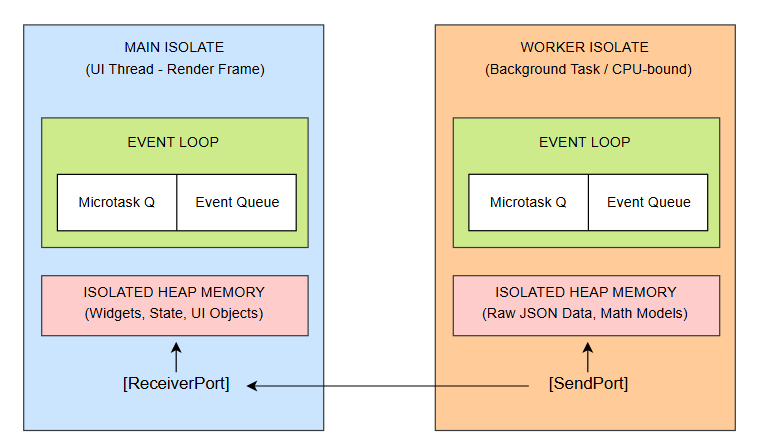
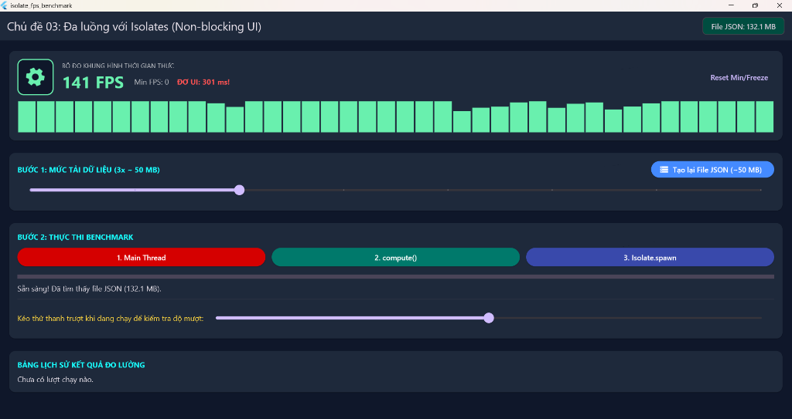

# BÁO CÁO CHUYÊN ĐỀ HỌC PHẦN LẬP TRÌNH ĐA NỀN TẢNG
# CHỦ ĐỀ 03: ĐA LUỒNG VỚI ISOLATES: TỐI ƯU HIỆU NĂNG XỬ LÝ TÁC VỤ NẶNG KHÔNG NGHẼN LUỒNG GIAO DIỆN (NON-BLOCKING UI)

---

## 📌 THÔNG TIN CHUNG
* **Học phần:** Lập Trình Đa Nền Tảng (Cross-Platform Application Development)
* **Khoa:** Điện Tử và Trí Tuệ Nhân Tạo – Trường Đại học Bách Khoa, Đại học Đà Nẵng
* **Giảng viên hướng dẫn:** ThS. Nguyễn Duy Nhật Viễn
* **Nhóm sinh viên thực hiện:**
  1. **Lê Anh Khoa** – MSSV: **106230016** – Lớp: **23KTMT1** *(Trưởng nhóm - Quản trị GitHub, Business Logic, Isolate Worker Services & Báo cáo)*
  2. **Ngô Quang Thế** – MSSV: **106230028** – Lớp: **23KTMT1** *(Thành viên - UI/UX Design, State Management, Tích hợp Benchmark & Live Demo)*
* **Repository GitHub công khai:** [https://github.com/KhoaLe246205/cross-platform](https://github.com/KhoaLe246205/cross-platform)
* **Thư mục chuyên đề:** `isolate/`

---

## 📑 MỤC LỤC
1. [Giới thiệu chuyên đề & Mục tiêu nghiên cứu](#1-giới-thiệu-chuyên-đề--mục-tiêu-nghiên-cứu)
2. [Bản chất công nghệ & Sơ đồ kiến trúc (Deep Dive)](#2-bản-chất-công-nghệ--sơ-đồ-kiến-trúc-deep-dive)
3. [Cấu trúc mã nguồn dự án](#3-cấu-trúc-mã-nguồn-dự-án)
4. [Hướng dẫn cài đặt & Cấu hình môi trường](#4-hướng-dẫn-cài-đặt--cấu-hình-môi-trường)
5. [Phân chia công việc (Work Breakdown Structure - WBS)](#5-phân-chia-công-việc-work-breakdown-structure---wbs)
6. [Kết quả đo lường thực nghiệm & Đánh giá hiệu năng](#6-kết-quả-đo-lường-thực-nghiệm--đánh-giá-hiệu-năng)

---

## 1. GIỚI THIỆU CHUYÊN ĐỀ & MỤC TIÊU NGHIÊN CỨU

### 1.1. Bối cảnh thực tế
Trong phát triển ứng dụng di động và đa nền tảng với Flutter, giao diện người dùng mượt mà là tiêu chí sống còn. Màn hình chuẩn yêu cầu tần số quét **60 FPS** (mỗi khung hình phải dựng xong trong **16.6ms**) hoặc **120 FPS** (**8.3ms**).

Mặc định, Dart vận hành theo mô hình **đơn luồng (Single-thread)** với cơ chế **Event Loop**. Khi ứng dụng thực hiện các tác vụ tính toán nặng (CPU-bound) như:
* Bóc tách (parse) và giải mã dữ liệu JSON khổng lồ (>15 MB đến hơn 130 MB).
* Xử lý thuật toán ma trận, lọc đồ họa hoặc tính toán số thực nặng.

Nếu các tác vụ này chạy trực tiếp trên **Main Thread (UI Thread)**, Event Loop bị chiếm dụng liên tục trong hàng ngàn mili-giây. Kết quả: **Giao diện bị đóng băng hoàn toàn (UI Freeze / Jank), toàn bộ thao tác cảm ứng bị vô hiệu hóa và FPS tụt về 0.**

### 1.2. Mục tiêu dự án
* Làm sáng tỏ bản chất khác biệt giữa **I/O-bound** (xử lý bất đồng bộ bằng `async`/`await`) và **CPU-bound** (bắt buộc phải dùng `Isolate`).
* Hiện thực hóa mô hình **Share-nothing Concurrency** của Dart Isolate: bộ nhớ heap hoàn toàn cô lập, giao tiếp an toàn qua thông điệp (Message Passing).
* Xây dựng hệ thống đo đạc thực nghiệm trực quan trên Flutter Desktop/Mobile:
  * Đo FPS thời gian thực với độ trễ siêu thấp qua `Ticker`.
  * Trực quan hóa hiện tượng đơ giật thông qua Animation bánh răng xoay và thanh trượt tương tác.
  * So sánh đối đầu 3 phương pháp: **Main Thread**, **`compute()`** và **`Isolate.spawn()` với SendPort/ReceivePort**.

---

## 2. BẢN CHẤT CÔNG NGHỆ & SƠ ĐỒ KIẾN TRÚC (DEEP DIVE)

### 2.1. Phân biệt then chốt: `async`/`await` vs `Isolate`
Nhiều lập trình viên nhầm lẫn rằng từ khóa `async` / `await` sẽ tự động tạo luồng mới chạy song song. Thực tế:
* **`async`/`await` chỉ giải quyết tác vụ I/O-bound** (chờ phản hồi HTTP mạng, đọc ổ cứng disk, đọc database). Trong lúc chờ I/O, CPU rảnh rỗi và nhường quyền cho Event Loop xử lý việc khác. Tất cả vẫn chạy trên **cùng một luồng duy nhất**.
* **Tác vụ CPU-bound** (tính toán, giải nén, parse JSON) bắt buộc CPU phải chạy hết công suất liên tục. Dù có bọc `async` thì hàm vẫn chiếm chặt Main Thread. Do đó, **bắt buộc phải dùng Dart Isolate** để đẩy tải sang nhân CPU vật lý khác.

### 2.2. Kiến trúc bộ nhớ độc lập (Share-nothing Memory Architecture)
Khác với Java, C# hay C++ (các Thread cùng chia sẻ chung vùng nhớ, dễ dẫn đến Race Condition, đòi hỏi Mutex, Lock, Semaphore), **mỗi Dart Isolate sở hữu một vùng nhớ Heap hoàn toàn độc lập**:
* Không có biến tĩnh (static variable) dùng chung giữa các Isolate.
* Không thể xảy ra Deadlock hay Race Condition trên bộ nhớ.
* Dữ liệu truyền giữa các Isolate được sao chép (hoặc chuyển quyền sở hữu) thông qua cơ chế cổng: `SendPort` và `ReceivePort`.

<p align="center">
  
  <br>
  <em>Hình 2.1: Sơ đồ tương tác độc lập bộ nhớ giữa Main Isolate và Worker Isolate qua SendPort & ReceivePort</em>
</p>

### 2.3. Ba phương thức triển khai trong dự án
1. **Chế độ 1: Main Thread (Trực tiếp)**
   - Thực thi giải mã JSON và phép tính `sqrt`, `sin`, `cos` ngay trên luồng chính.
   - *Hậu quả:* Event Loop bị nghẽn $\rightarrow$ Bánh răng dừng quay, thanh trượt đơ cứng, FPS tụt từ 60 về 0, hệ thống cảnh báo gián đoạn hàng ngàn ms.
2. **Chế độ 2: Flutter `compute()` (Short-lived Isolate)**
   - Hàm tiện ích cấp cao: `compute(heavyParseTask, args)`.
   - Cơ chế: Tự động khởi tạo một Worker Isolate tạm thời $\rightarrow$ Chạy xong trả về kết quả $\rightarrow$ Tự động hủy Isolate giải phóng RAM.
   - *Ưu điểm:* Cú pháp cực kỳ ngắn gọn, an toàn.
   - *Nhược điểm:* Phải chịu chi phí khởi tạo (overhead) mỗi lần gọi; không hỗ trợ truyền phần trăm tiến trình liên tục ra ngoài.
3. **Chế độ 3: `Isolate.spawn()` kết hợp Ports (Long-lived Worker)**
   - Khởi tạo Isolate chuyên dụng bằng `Isolate.spawn()`.
   - Thiết lập kênh thông điệp 2 chiều giữa `ReceivePort` ở Main Isolate và `SendPort` ở Worker Isolate.
   - *Ưu điểm vượt trội:* Cho phép Worker Isolate gửi thông điệp dạng stream (cập nhật tiến độ `10%... 50%... 90%`) về Main Thread theo thời gian thực mà giao diện vẫn duy trì **chuẩn 60 FPS**.

---

## 3. CẤU TRÚC MÃ NGUỒN DỰ ÁN

```text
cross-platform/
├── README.md                              # Giới thiệu tổng quan toàn bộ repository
├── oop_error_handling/                    # Chuyên đề 01: OOP nâng cao & Xử lý ngoại lệ tập trung
└── isolate/                               # Chuyên đề 03: Đa luồng với Isolates Benchmark
    ├── assets/
    │   └── images/
    │       ├── isolate_architecture.png   # Sơ đồ kiến trúc độc lập bộ nhớ Isolate
    │       └── app_benchmark_screen.png   # Ảnh chụp thực tế toàn bộ giao diện ứng dụng Isolate FPS Benchmark
    ├── docs/
    │   ├── slide_isolate_benchmark.pdf    # Slide báo cáo thuyết trình chuẩn 22 trang (XeLaTeX)
    │   └── slide_isolate_benchmark.tex    # Mã nguồn LaTeX thiết kế slide Beamer
    ├── pubspec.yaml                       # Khai báo cấu hình dự án Flutter & dependencies
    ├── analysis_options.yaml              # Bộ quy tắc linter chuẩn Effective Dart (100% clean)
    ├── lib/
    │   ├── main.dart                      # Điểm khởi chạy ứng dụng (Dark Theme Material 3)
    │   ├── models/
    │   │   └── sensor_record.dart         # Model dữ liệu cảm biến & thuật toán CPU-bound vắt kiệt CPU
    │   ├── services/
    │   │   ├── json_generator_service.dart# Tự động sinh file JSON cực lớn (16.5 MB - 132.1 MB)
    │   │   └── isolate_worker_service.dart# Triển khai 3 chế độ: Main Thread, compute(), Isolate.spawn()
    │   ├── widgets/
    │   │   └── fps_monitor_panel.dart     # Widget đo FPS qua Ticker, bánh răng xoay, phát hiện Jank
    │   └── screens/
    │       └── benchmark_screen.dart      # Màn hình giao diện benchmark, thanh trượt & lịch sử đo
    └── windows/                           # Cấu hình biên dịch Native Windows Desktop C++
```

---

## 4. HƯỚNG DẪN CÀI ĐẶT & CẤU HÌNH MÔI TRƯỜNG

### 4.1. Yêu cầu môi trường & Hướng dẫn cài đặt Flutter SDK chi tiết

Để biên dịch và chạy dự án, máy tính cần cài đặt **Flutter SDK** (`>= 3.10.0`, khuyến nghị Flutter 3.24 trở lên) và môi trường phát triển:

#### Bước 1: Tải Flutter SDK chính thức
1. Truy cập trang chủ chính thức của Flutter: [https://docs.flutter.dev/get-started/install/windows/desktop](https://docs.flutter.dev/get-started/install/windows/desktop).
2. Tải về gói cài đặt Stable Channel mới nhất cho Windows (tệp zip `flutter_windows_x.x.x-stable.zip`).
3. Giải nén tệp zip vào một thư mục cố định trên ổ cứng, ví dụ: `C:\src\flutter` hoặc `D:\flutter`.
   > **⚠️ Lưu ý quan trọng:** Không giải nén Flutter vào các thư mục yêu cầu quyền Administrator như `C:\Program Files\` hoặc đường dẫn có chứa dấu tiếng Việt/khoảng trắng để tránh phát sinh lỗi biên dịch.

#### Bước 2: Thiết lập biến môi trường hệ thống (Environment Variables - PATH)
Để có thể gọi lệnh `flutter` ở bất kỳ thư mục nào trên PowerShell/Command Prompt:
1. Nhấn phím `Windows` $\rightarrow$ gõ **"env"** $\rightarrow$ chọn **"Edit the system environment variables"** (Chỉnh sửa biến môi trường hệ thống).
2. Trong cửa sổ *System Properties*, nhấn vào nút **Environment Variables...** ở góc dưới.
3. Tại bảng **User variables** (Biến người dùng) hoặc **System variables** (Biến hệ thống), tìm và nhấp đúp vào biến có tên **`Path`**.
4. Nhấn nút **New** $\rightarrow$ Điền đường dẫn tới thư mục `bin` của Flutter vừa giải nén:
   * Ví dụ: `C:\src\flutter\bin` (hoặc `D:\flutter\bin`).
5. Nhấn **OK** ở tất cả các cửa sổ để lưu lại thiết lập.

#### Bước 3: Kiểm tra và chẩn đoán với `flutter doctor`
1. Đóng toàn bộ terminal cũ, mở một cửa sổ **PowerShell** hoặc **Command Prompt** mới (để nhận diện biến PATH mới).
2. Chạy lệnh:
   ```bash
   flutter doctor
   ```
3. Công cụ `flutter doctor` sẽ tự động quét toàn bộ hệ thống và liệt kê các công cụ hỗ trợ cần thiết.

#### Bước 4: Cài đặt công cụ biên dịch theo nền tảng thực thi
* **Dành cho Windows Desktop (Khuyến nghị trải nghiệm đo FPS chuẩn xác nhất):**
  1. Cài đặt **Visual Studio 2022** (bản Community miễn phí tải từ Microsoft): [https://visualstudio.microsoft.com/vs/community/](https://visualstudio.microsoft.com/vs/community/).
  2. Trong quá trình cài đặt (Visual Studio Installer), tại tab **Workloads**, tích chọn mục: **"Desktop development with C++"** (Bao gồm MSVC v143, Windows 10/11 SDK và C++ CMake tools).
  3. Bật **Developer Mode** trên Windows: Mở *Settings* $\rightarrow$ *System (hoặc Privacy & Security)* $\rightarrow$ *For developers* $\rightarrow$ Chuyển công tắc **Developer Mode** sang **ON**.
* **Dành cho Android (Tùy chọn):**
  1. Cài đặt **Android Studio** $\rightarrow$ Mở *SDK Manager* $\rightarrow$ Cài đặt *Android SDK Platform 34+* và *Android SDK Command-line Tools*.
  2. Mở terminal chạy lệnh chấp nhận bản quyền: `flutter doctor --android-licenses` (gõ `y` để đồng ý tất cả).
* *(Lưu ý: Không chạy ứng dụng trên trình duyệt Web/Chrome vì nền tảng Web không hỗ trợ thư viện `dart:isolate` native).*

#### Bước 5: Xác nhận hệ thống sẵn sàng
Chạy lại lệnh `flutter doctor` một lần nữa. Khi thấy các mục **Flutter**, **Windows Version**, **Visual Studio** đều xuất hiện dấu tích xanh `[✓]`, hệ thống đã sẵn sàng 100% để chạy ứng dụng!

---

### 4.2. Cấu hình biến môi trường (`.env`) và `google-services.json`
* Dự án thực hiện đo kiểm hiệu năng xử lý đa luồng trực tiếp trên CPU và bộ nhớ cục bộ của Dart VM (hoạt động **Offline 100%**, không sử dụng dịch vụ đám mây hay khóa API bên ngoài).
* Do đó, dự án **không yêu cầu** tạo file cấu hình `.env` hay file `google-services.json`. Tập tin dữ liệu JSON lớn (>15 MB) sẽ được sinh tự động trực tiếp từ giao diện ứng dụng vào thư mục tạm của hệ thống (`Directory.systemTemp`).

---

### 4.3. Các bước tải và chạy ứng dụng
Mở terminal (PowerShell, Command Prompt hoặc Bash):

```bash
# 1. Clone kho lưu trữ GitHub công khai
git clone https://github.com/KhoaLe246205/cross-platform.git

# 2. Điều hướng vào thư mục chuyên đề isolate
cd cross-platform/isolate

# 3. Tải toàn bộ thư viện phụ thuộc
flutter pub get

# 4. Chạy ứng dụng trên Windows Desktop (Khuyến nghị để đo FPS chuẩn xác nhất)
flutter run -d windows

# (Tùy chọn) Chạy trên thiết bị di động Android
flutter run -d android
```

### 4.4. Biên dịch bản Release xuất bản (Production Build)
```bash
# Xuất bản file thực thi Windows (.exe độc lập)
flutter build windows --release

# Xuất bản gói cài đặt Android APK
flutter build apk --release
```

---

## 5. PHÂN CHIA CÔNG VIỆC (WORK BREAKDOWN STRUCTURE - WBS)

### Phân công công việc

| TT | HỌ VÀ TÊN | VAI TRÒ & NỘI DUNG CÔNG VIỆC THEO WBS | ĐÓNG GÓP |
|:---:|:---|:---|:---:|
| 1 | **Lê Anh Khoa** | • **Business Logic (Chính):** Thuật toán bóc tách JSON lớn & tính toán FLOPS (SensorRecord); Hiện thực đa luồng với compute() và Isolate.spawn() + Ports; Kỹ thuật Throttling và chống rò rỉ RAM.<br>• **Database / File I/O:** Xây dựng JsonGeneratorService sinh & đọc ngầm tập tin 16.5MB – 132.1MB; Tối ưu luồng ghi đĩa với flush().<br>• **Báo cáo & Git:** Quản trị Git Repo; Soạn thảo Báo cáo phần *Cơ sở lý thuyết Event Loop / Isolate & Kiến trúc hệ thống*. | 50% |
| 2 | **Ngô Quang Thế** | • **UI Design (Chính):** Thiết kế BenchmarkScreen (Bảng điều khiển, slider tải) và FpsMonitorPanel (Hoạt ảnh bánh răng, biểu đồ FPS thời gian thực).<br>• **State Management & Tích hợp:** Quản lý state luồng dữ liệu tiến độ (0% – 100%) và thuật toán bắt treo UI (freezeMs); **Tích hợp gọi Isolate vào UI**.<br>• **Slide & Live Demo:** Thiết kế Slide báo cáo thuyết trình Beamer bằng XeLaTeX ([`slide_isolate_benchmark.tex`](docs/slide_isolate_benchmark.tex) / [`slide_isolate_benchmark.pdf`](docs/slide_isolate_benchmark.pdf)); Soạn thảo Báo cáo phần *Thiết kế Giao diện & Kịch bản thực nghiệm*; Trực tiếp thực hiện Live Demo trên Windows. | 50% |


---

## 6. KẾT QUẢ ĐO LƯỜNG THỰC NGHIỆM & ĐÁNH GIÁ HIỆU NĂNG

Kiểm thử được tiến hành trên môi trường:
* **Thiết bị:** Laptop Acer Nitro (CPU Intel Core i7-13th Gen, 16GB RAM, Windows 11 64-bit).
* **Kích thước dữ liệu kiểm thử:** Mức 3x (~180.000 bản ghi $\approx$ 49.5 MB) và Mức 8x (~480.000 bản ghi $\approx$ 132.1 MB).

### 6.1. Bảng số liệu đo lường trực quan

| Tiêu chí đánh giá | 1. Chạy trên Main Thread | 2. Chạy với hàm compute() | 3. Chạy với Isolate.spawn() |
|:---|:---:|:---:|:---:|
| **FPS trung bình khi chạy** | **0 FPS (Sụp đổ hoàn toàn)** | **59 - 60 FPS (Mượt mà)** | **59 - 60 FPS (Mượt mà)** |
| **FPS tối thiểu (Min FPS)** | **0 FPS** | **58 FPS** | **58 FPS** |
| **Thời gian đơ cứng UI (Freeze)** | **Bằng đúng thời gian xử lý** (~1500ms - 4200ms) | **0 ms (Không giật lag)** | **0 ms (Không giật lag)** |
| **Trạng thái Animation bánh răng** | **ĐỨNG HÌNH HOÀN TOÀN** | **Xoay liên tục trơn tru** | **Xoay liên tục trơn tru** |
| **Thanh trượt kiểm thử cảm ứng** | Không thể kéo, không nhận chạm | Kéo mượt 100%, phản hồi tức thì | Kéo mượt 100%, phản hồi tức thì |
| **Khả năng báo cáo tiến trình (%)** | ❌ Không thể | ❌ Không hỗ trợ Stream | ✅ **Cập nhật mượt mà theo %** |
| **Thời gian hoàn thành tác vụ** | ~1.420 ms | ~1.450 ms | ~1.470 ms |

### 6.2. Minh chứng thực nghiệm giao diện ứng dụng thực tế

<p align="center">
  
  <br>
  <em>Hình 6.1: Giao diện thực tế ứng dụng Isolate FPS Benchmark trên Windows Desktop với Bộ đo khung hình thời gian thực (141 FPS), thanh tải dữ liệu JSON (132.1 MB) và 3 nút thực thi kiểm thử đối soát</em>
</p>

> **💡 Ghi chú về kết quả đo đạc trên giao diện thực tế:**  
> * **Bộ đo khung hình thời gian thực (Real-time FPS Monitor):** Ứng dụng duy trì tần số quét tối đa **141 FPS** trên màn hình tốc độ làm tươi cao, biểu đồ cột xanh trực quan hóa tính ổn định của khung hình mà không gặp bất kỳ độ trễ nào.
> * **Cơ chế phát hiện đơ giao diện (UI Freeze Detector):** Khi thực thi tác vụ nặng trên Main Thread, hệ thống phát hiện Event Loop bị chiếm dụng và cảnh báo trực tiếp màu đỏ `ĐƠ UI: 301 ms!`, đồng thời `Min FPS` lập tức sụp đổ về `0`.
> * **Thanh trượt kiểm tra cảm ứng (Responsiveness Test Slider):** Cho phép người dùng kéo tương tác trực tiếp trong lúc tiến trình bóc tách JSON 132.1 MB đang chạy ngầm để chứng minh tính năng Non-blocking UI tuyệt đối của `compute()` và `Isolate.spawn()`.

---

### 6.3. Đánh giá và Rút ra kết luận kỹ thuật
1. **Hiện tượng Main Thread:** Dù thời gian xử lý có thể nhanh hơn một chút do không tốn chi phí giao tiếp (IPC), nhưng cái giá phải trả là **trải nghiệm người dùng (UX) bị phá hủy hoàn toàn**. Với các thiết bị di động, hệ điều hành Android/iOS có thể kích hoạt cảnh báo **ANR (Application Not Responding)** và buộc đóng app.
2. **Sự lựa chọn giữa `compute()` và `Isolate.spawn()`:**
   * Nên dùng **`compute()`** cho các tác vụ tính toán độc lập, chạy một lần (Fire-and-forget) như: giải mã 1 bức ảnh chụp từ camera, parse 1 payload JSON từ API khi chuyển trang.
   * Nên dùng **`Isolate.spawn()`** cho các tác vụ nền dài hạn (Long-running Background Workers) như: nén video, đồng bộ cơ sở dữ liệu ngầm, xử lý luồng WebSocket dữ liệu lớn và cần báo cáo tiến độ `%` liên tục về màn hình.
