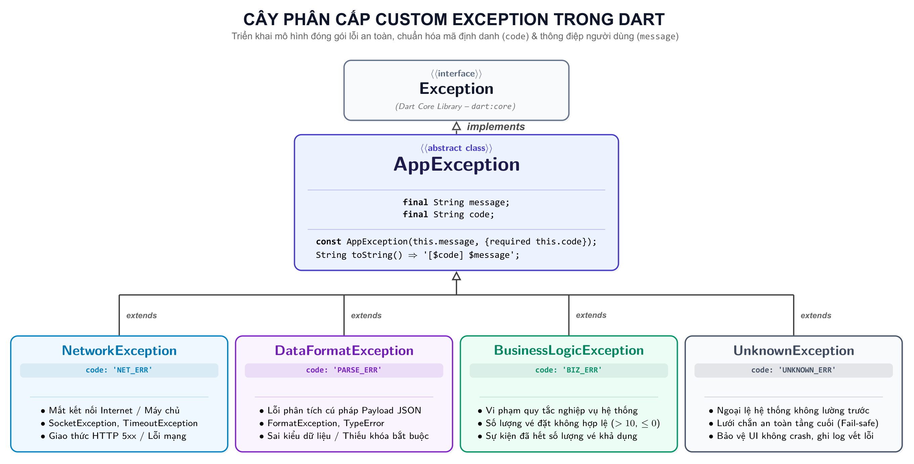
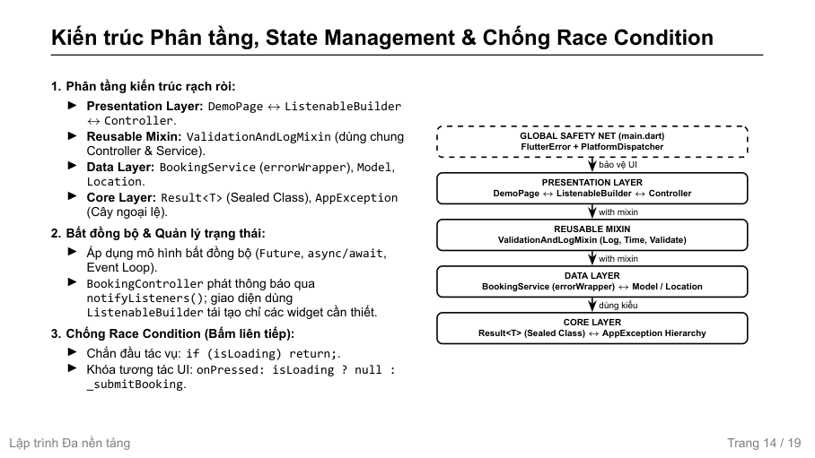
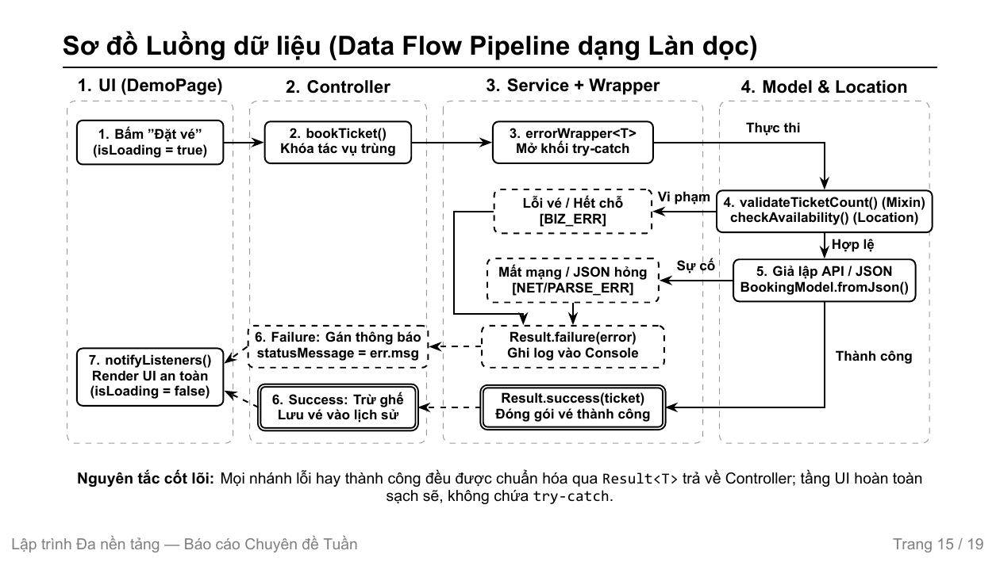
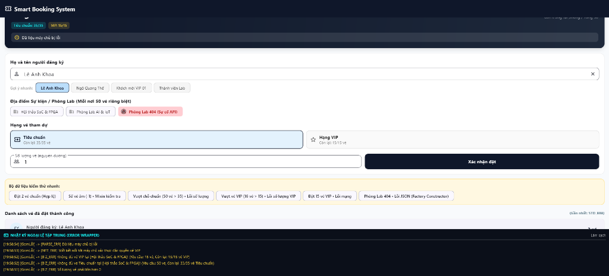

# BÁO CÁO CHUYÊN ĐỀ HỌC PHẦN LẬP TRÌNH ĐA NỀN TẢNG
# CHỦ ĐỀ 01: OOP NÂNG CAO & XỬ LÝ NGOẠI LỆ TẬP TRUNG TRONG DART: XÂY DỰNG MODULE QUẢN LÝ DỮ LIỆU AN TOÀN, LOẠI BỎ CRASH VÀ CÁCH LY LỖI

---

## 📌 THÔNG TIN CHUNG
* **Học phần:** Lập Trình Đa Nền Tảng (Cross-Platform Application Development)
* **Khoa:** Điện Tử và Trí Tuệ Nhân Tạo – Trường Đại học Bách Khoa, Đại học Đà Nẵng
* **Giảng viên hướng dẫn:** ThS. Nguyễn Duy Nhật Viễn
* **Nhóm sinh viên thực hiện:**
  1. **Lê Anh Khoa** – MSSV: **106230016** – Lớp: **23KTMT1** *(Trưởng nhóm - Quản trị GitHub, OOP Core & Architecture, Error Wrapper, Result Pattern, Slide & Báo cáo)*
  2. **Ngô Quang Thế** – MSSV: **106230028** – Lớp: **23KTMT1** *(Thành viên - UI/UX Design, State Management, Custom Exceptions, Global Safety Net & Live Demo)*
* **Repository GitHub công khai:** [https://github.com/KhoaLe246205/cross-platform](https://github.com/KhoaLe246205/cross-platform)
* **Thư mục chuyên đề:** `oop_error_handling/`

---

## 📑 MỤC LỤC
1. [Giới thiệu chuyên đề & Mục tiêu nghiên cứu](#1-giới-thiệu-chuyên-đề--mục-tiêu-nghiên-cứu)
2. [Bản chất công nghệ & Sơ đồ kiến trúc (Deep Dive)](#2-bản-chất-công-nghệ--sơ-đồ-kiến-trúc-deep-dive)
3. [Cấu trúc mã nguồn dự án](#3-cấu-trúc-mã-nguồn-dự-án)
4. [Hướng dẫn cài đặt & Cấu hình môi trường](#4-hướng-dẫn-cài-đặt--cấu-hình-môi-trường)
5. [Phân chia công việc (Work Breakdown Structure - WBS)](#5-phân-chia-công-việc-work-breakdown-structure---wbs)
6. [Kịch bản thực nghiệm, Bảng ca kiểm thử Live Demo & Đánh giá hiệu quả](#6-kịch-bản-thực-nghiệm-bảng-ca-kiểm-thử-live-demo--đánh-giá-hiệu-quả)

---

## 1. GIỚI THIỆU CHUYÊN ĐỀ & MỤC TIÊU NGHIÊN CỨU

### 1.1. Bối cảnh thực tế
Trong quá trình xây dựng các ứng dụng di động và đa nền tảng quy mô thực tế bằng Flutter, việc bảo toàn trạng thái ứng dụng và duy trì trải nghiệm người dùng liền mạch (User Experience) là yếu tố sống còn. Tuy nhiên, mã nguồn phần mềm thường xuyên phải đương đầu với hàng loạt rủi ro ngoại lệ trong thời gian chạy (Runtime Exceptions):
* **Sự cố mạng và máy chủ:** Mất kết nối Internet đột ngột (`SocketException`), máy chủ trả về mã lỗi HTTP 5xx hoặc timeout khi đang xử lý thanh toán/đặt chỗ.
* **Sai lệch cấu trúc dữ liệu (Data Mismatch / Format Errors):** Dữ liệu JSON trả về bị thiếu trường bắt buộc (`null`), sai kiểu dữ liệu (`String` thay vì `int`), hoặc chuỗi JSON bị cắt cụt do đường truyền.
* **Vi phạm ràng buộc nghiệp vụ (Domain Violations):** Người dùng cố tình nhập số lượng âm, yêu cầu đặt vượt quá số ghế còn lại của sự kiện phòng lab, hoặc chọn loại vé không hợp lệ.
* **Xung đột điều khiển dồn dập (Race Condition / Rapid Taps):** Người dùng bấm liên tiếp nhiều lần vào nút hành động khi tác vụ trước chưa kịp hoàn tất, gây ra các yêu cầu ghi dữ liệu trùng lặp.
* **Ngoại lệ bất đồng bộ lọt ra ngoài luồng (Unhandled Async Exceptions):** Các lỗi phát sinh bên trong luồng `Future` hoặc Event Loop không được bao bọc cẩn thận, dẫn đến hiện tượng **văng ứng dụng đột ngột (App Crash)** hoặc xuất hiện **màn hình xám/đỏ (Red Screen of Death)**.

### 1.2. Mục tiêu dự án
* **Làm chủ và ứng dụng sâu sắc các tính năng OOP nâng cao của Dart 3:** Khởi tạo định danh (*Named Constructor*), khởi tạo điều hướng (*Redirecting Factory Constructor*), đóng gói nghiệp vụ chuyển đổi JSON bằng *Factory Constructor*, tái sử dụng hành vi không qua kế thừa bằng *Mixin* (`with`, ràng buộc `on`), bảo đảm an toàn kiểu lúc thực thi với *Reified Generics & Bounded Type* (`<T extends X>`), và triệt tiêu trạng thái không hợp lệ thông qua *Sealed Class* kết hợp *Exhaustive Pattern Matching*.
* **Xây dựng hệ sinh thái phòng thủ lỗi tập trung và cách ly đa tầng:**
  * Thiết kế cây phân cấp ngoại lệ tùy biến [`AppException`](lib/core/error/app_exception.dart) với các nhóm mã lỗi chuẩn hóa (`NET_ERR`, `PARSE_ERR`, `BIZ_ERR`, `UNKNOWN_ERR`).
  * Hiện thực hóa mô hình [`Result<T>`](lib/core/utils/result.dart) (`Success<T>` và `Failure<T>`) thay thế triệt để cho việc ném lỗi lung tung (`throw`) giữa các tầng kiến trúc.
  * Xây dựng hàm bao bọc an toàn [`errorWrapper<T>`](lib/data/services/booking_service.dart) ở tầng biên Service để bắt trọn mọi sự cố, ghi vết ngăn xếp (`StackTrace`) và dọn dẹp tài nguyên với `finally`.
  * Cài đặt **Lưới an toàn toàn cục 2 lớp (Global Safety Net)** tại [`main.dart`](lib/main.dart) (`FlutterError.onError` cho UI và `PlatformDispatcher.onError` cho Async) để cách ly 100% lỗi thoát ra ngoài luồng.
* **Minh chứng giải pháp bằng ứng dụng thực nghiệm Smart Booking System:** Trực quan hóa toàn bộ luồng xử lý lỗi thông qua giao diện Banner phản hồi thân thiện cho người dùng, đồng thời đẩy mã log kỹ thuật chi tiết xuống khối Terminal Console trên ứng dụng.

---

## 2. BẢN CHẤT CÔNG NGHỆ & SƠ ĐỒ KIẾN TRÚC (DEEP DIVE)

### 2.1. Nền tảng OOP nâng cao trong Dart

#### 2.1.1. Bốn trụ cột OOP & Thiết kế Lớp bất biến (Immutable Object)
* **Đóng gói (Encapsulation):** Trong Dart, phạm vi truy cập private được định nghĩa ở cấp độ thư viện (*library-level*) bằng tiền tố gạch dưới `_`, thay vì cấp độ class như Java/C++.
* **Kế thừa (Inheritance) & Trừu tượng (Abstraction):** Dart sử dụng mô hình đơn kế thừa qua `extends` và cho phép hiện thực nhiều giao diện qua `implements` (mọi class trong Dart đều ngầm định là một interface).
* **Đa hình (Polymorphism):** Ghi đè phương thức với `@override` và xử lý đa hình tại thời điểm runtime.
* **Lớp bất biến (Immutable Object):**
  * Tất cả các trường dữ liệu của [`BookingModel`](lib/data/models/booking_model.dart) đều khai báo `final`.
  * Khởi tạo đối tượng thông qua `const constructor`.
  * *Lợi ích:* Trạng thái không thể bị biến đổi ngoài ý muốn sau khi khởi tạo, đảm bảo an toàn tuyệt đối khi truyền qua các tầng kiến trúc bất đồng bộ, tối ưu hóa bộ nhớ RAM nhờ cơ chế chia sẻ thể hiện (*Canonicalization*).

```dart
class BookingModel {
  static const String defaultLabEvent = 'Hội thảo SoC & FPGA';

  final String id;
  final int amount;
  final TicketType type;
  final String labEvent;

  const BookingModel({
    required this.id,
    required this.amount,
    required this.type,
    this.labEvent = defaultLabEvent,
  });
}
```

#### 2.1.2. Constructor: Named, Factory & Redirecting Factory
* **Named Constructor:** Dart không hỗ trợ nạp chồng phương thức (*Method Overloading*) cùng tên. Do đó, Dart giải quyết bằng cú pháp `ClassName.tênRiêng()` kết hợp danh sách khởi tạo (*Initializer List*) để gán trường `final` trước khi thân hàm thực thi.
* **Factory Constructor:** Không tự động tạo thể hiện mới; bắt buộc phải có lệnh `return`. Cho phép trả về instance từ bộ nhớ đệm (Cache/Singleton), trả về thể hiện của lớp con, và chứa logic thẩm định nghiệp vụ chuyển đổi JSON:
* **Redirecting Factory Constructor:** Sử dụng từ khóa `factory` kết hợp dấu `=` để chuyển hướng trực tiếp đến constructor của lớp con tương ứng, che giấu chi tiết cài đặt phía sau lớp cha.

```dart
// 1. Named Constructor: Khởi tạo đối tượng rỗng an toàn với Initializer List
const BookingModel.empty()
    : id = 'N/A',
      amount = 0,
      type = TicketType.standard,
      labEvent = 'Chưa có thông tin';

// 2. Factory Constructor: Thẩm định & bóc tách JSON an toàn bằng Dart 3 Pattern Matching
factory BookingModel.fromJson(Map<String, dynamic> json) {
  if (json case {'id': final id, 'amount': int amount}) {
    try {
      final rawType = json['type']?.toString() ?? 'standard';
      return BookingModel(
        id: '$id',
        amount: amount,
        type: TicketType.values.byName(rawType),
        labEvent: (json['labEvent'] as String?) ?? defaultLabEvent,
      );
    } on ArgumentError {
      throw DataFormatException('Loại vé "${json['type']}" không tồn tại');
    } on TypeError {
      throw const DataFormatException('Dữ liệu JSON sai kiểu dữ liệu');
    }
  }
  throw const DataFormatException('Dữ liệu máy chủ bị lỗi');
}
```

##### Bảng so sánh 3 loại Constructor trong Dart:
| TIÊU CHÍ SO SÁNH | NAMED CONSTRUCTOR | FACTORY CONSTRUCTOR | REDIRECTING FACTORY |
|:---|:---:|:---:|:---:|
| **Tự động cấp phát Instance** | Có | ❌ Không (bắt buộc dùng `return`) | ❌ Không |
| **Dùng `this` / Initializer List** | Có | ❌ Không | ❌ Không |
| **Cho phép trả về Lớp con** | ❌ Không | Có | Có |
| **Chứa logic nghiệp vụ / Validate** | Có (rất hạn chế) | **Có (hoàn chỉnh, ném ngoại lệ)** | ❌ Không |
| **Cú pháp minh họa** | `BookingModel.empty()` | `factory BookingModel.fromJson()` | `factory Result.success() = Success<T>` |

#### 2.1.3. Cơ chế Mixin: Tái sử dụng tính năng không qua kế thừa
* **Bản chất:** Cho phép nhúng mã nguồn (phương thức, thuộc tính) vào một class mà không tạo mối quan hệ cha - con ("is-a").
* **Giải quyết xung đột hình thoi (Diamond Problem):** Dart giải quyết xung đột bằng thuật toán **Linearization** (thứ tự khai báo từ trái sang phải: mixin sau sẽ ghi đè phương thức trùng tên của mixin trước).
* **Từ khóa `on`:** Giới hạn mixin chỉ được phép nhúng vào các lớp con của một lớp cơ sở định sẵn, cho phép gọi `super.method()`.
* **Lý do bắt buộc dùng `with`:** Dart là ngôn ngữ **đơn kế thừa**. Lớp [`BookingController`](lib/presentation/controllers/booking_controller.dart) đã kế thừa `extends ChangeNotifier`, do đó bắt buộc phải dùng từ khóa `with ValidationAndLogMixin` để tích hợp tính năng validate và log thời gian.

```dart
mixin ValidationAndLogMixin {
  /// Kiểm tra số lượng vé phải là số nguyên dương (> 0)
  void validateTicketCount(int count) {
    if (count <= 0) {
      throw const BusinessLogicException('Số lượng vé phải lớn hơn 0');
    }
  }

  /// Định dạng mốc thời gian chuẩn (HH:mm:ss) dùng chung toàn hệ thống
  String formatCurrentTime() {
    return DateTime.now().toIso8601String().substring(11, 19);
  }

  /// Tự động in log chuẩn hóa với mốc thời gian
  void logInfo(String tag, String message) {
    debugPrint('[${formatCurrentTime()}] [INFO] [$tag]: $message');
  }
}
```

#### 2.1.4. Generics: Reified Generics & Bounded Type
* **Reified Generics trong Dart:** Khác biệt căn bản với Java (sử dụng cơ chế *Type Erasure* - xóa thông tin kiểu sau khi biên dịch), Dart **bảo toàn thông tin kiểu generic trong suốt thời gian chạy (Runtime)**. Điều này cho phép thực hiện kiểm tra kiểu chính xác: `if (result is Result<BookingModel>)`.
* **Ràng buộc Generics (Bounded Type - `<T extends X>`):** Giới hạn tham số kiểu dữ liệu generic chỉ được nhận các lớp con kế thừa từ một kiểu định sẵn (ví dụ: `<E extends AppException>`).
* **Non-nullable Bound:** Trong môi trường Sound Null Safety của Dart, viết `<T extends Object>` giúp loại trừ triệt để giá trị `null` khỏi kiểu generic.

#### 2.1.5. Sealed Class & Pattern Matching (Dart 3)
* **Khóa cây kế thừa:** Khai báo `sealed class Result<T>` ngăn chặn việc mở rộng lớp con từ các thư viện bên ngoài. Mọi lớp con (`Success<T>`, `Failure<T>`) bắt buộc phải được khai báo trong cùng một tập tin.
* **Exhaustive Pattern Matching:** Trình biên dịch bắt buộc cấu trúc `switch-case` phải xử lý triệt để 100% các phân lớp. Nếu lập trình viên bỏ sót bất kỳ nhánh nào, trình biên dịch sẽ báo lỗi ngay lập tức lúc build:
* **Triệt tiêu trạng thái nhập nhằng:** Loại bỏ vĩnh viễn mẫu thiết kế cũ thiếu an toàn (*"vừa chứa data vừa chứa error"*).

```dart
sealed class Result<T> {
  const Result();
  factory Result.success(T data) = Success<T>;
  factory Result.failure(AppException error) = Failure<T>;
}

// Bóc tách an toàn tuyệt đối với Pattern Matching
switch (result) {
  case Success(:final data):
    isLastActionSuccess = true;
    lastBookedTicket = data;
    location.deductSeats(type, data.amount);
    
  case Failure(:final error):
    isLastActionSuccess = false;
    statusMessage = error.message;
}
```

---

### 2.2. Chiến lược xử lý ngoại lệ tập trung (Error Handling Strategy)

#### 2.2.1. Phân biệt then chốt: `Exception` vs `Error`
* **`Exception`:** Đại diện cho các điều kiện ngoại lệ có thể lường trước trong thời gian chạy (mất mạng, dữ liệu hỏng, hết ghế). Ứng dụng **phải bắt (`catch`), cách ly và tự phục hồi**.
* **`Error`:** Đại diện cho các lỗi lập trình sai cú pháp/logic do nhà phát triển (`TypeError`, `RangeError`, `NoSuchMethodError`). Về nguyên tắc không được bắt để che giấu mà phải sửa code; tuy nhiên tại tầng biên (Global Safety Net), ứng dụng bắt giữ nhằm chống crash đột ngột và log vết ngăn xếp.
* **Hai quy tắc vàng khi bắt ngoại lệ trong Dart:**
  1. Khối `on CustomException` cụ thể phải luôn đặt **trước** khối `catch (e)` tổng quát.
  2. Khối `finally` **luôn luôn thực thi** để giải phóng tài nguyên kể cả khi khối `try` đã gọi lệnh `return`.

#### 2.2.2. Cây phân cấp Custom Exception (`AppException`)
Ứng dụng xây dựng lớp trừu tượng [`AppException`](lib/core/error/app_exception.dart) triển khai interface `Exception`, tích hợp mã định danh kỹ thuật (`code`) và thông điệp người dùng (`message`):

<p align="center">
  
</p>

#### 2.2.3. Cổng Fail-safe `errorWrapper<T>` & Result Pattern
Tầng Service sử dụng hàm bao bọc cấp cao [`errorWrapper<T>`](lib/data/services/booking_service.dart#L17-L38) để đóng gói toàn bộ các tác vụ gọi dữ liệu:

```dart
Future<Result<T>> errorWrapper<T>(
  Future<T> Function() action, {
  String actionName = 'Tác vụ',
}) async {
  logInfo('Wrapper', 'Bắt đầu thực thi: $actionName');
  try {
    final data = await action();
    return Result.success(data);
  } on AppException catch (e) {
    _recordError(e.toString()); // Ghi log kỹ thuật vào Console
    return Result.failure(e);   // Trả về lỗi định kiểu an toàn
  } catch (e, stackTrace) {
    // Tách biệt: Thông báo thân thiện cho UI, chi tiết kỹ thuật thô vào log kèm StackTrace
    _recordError('Ngoại lệ hệ thống chưa bắt: $e\n$stackTrace');
    const friendlyErr = UnknownException(
        'Đã có lỗi xảy ra trong quá trình xử lý, vui lòng thử lại');
    return Result.failure(friendlyErr);
  } finally {
    // Luôn luôn thực thi dọn dẹp và kết thúc phiên
    logInfo('Wrapper', 'Hoàn tất phiên xử lý: $actionName');
  }
}
```

##### Ma trận điều phối và ánh xạ thông báo:
| NGUYÊN NHÂN SỰ CỐ | PHÂN LOẠI NGOẠI LỆ | MÃ LỖI | THÔNG BÁO THÂN THIỆN TRÊN UI |
|:---|:---|:---:|:---|
| Số vé $\le 0$ / Vượt quá số ghế | `BusinessLogicException` | `[BIZ_ERR]` | *"Số lượng vé phải lớn hơn 0"* / *"Không đủ vé tại phòng lab..."* |
| Mất mạng / Timeout máy chủ | `NetworkException` | `[NET_ERR]` | *"Mất kết nối tới máy chủ xác thực đặc quyền..."* |
| Dữ liệu JSON sai format/thiếu id | `DataFormatException` | `[PARSE_ERR]` | *"Dữ liệu máy chủ bị lỗi"* |
| Sự cố hệ thống bất ngờ khác | `UnknownException` | `[UNKNOWN_ERR]` | *"Đã có lỗi xảy ra trong quá trình xử lý, vui lòng thử lại"* |

#### 2.2.4. Lưới an toàn toàn cục 2 lớp (Global Safety Net)
Cài đặt tại hàm `main()` trong [`lib/main.dart`](lib/main.dart) bảo vệ ứng dụng theo chiều sâu (*Defense-in-Depth*):
* **Lớp 1 (Framework UI):** `FlutterError.onError` bắt trọn các lỗi dựng giao diện, render widget hoặc layout overflow.
* **Lớp 2 (Platform Async):** `PlatformDispatcher.instance.onError` bắt toàn bộ các ngoại lệ bất đồng bộ bị văng ra khỏi các chuỗi Future.
* **Giá trị trả về `return true;`:** Báo cho Flutter engine biết lỗi đã được xử lý an toàn, ngăn chặn việc dừng app đột ngột và đẩy log trực tiếp lên Terminal Console.

```dart
void main() {
  WidgetsFlutterBinding.ensureInitialized();
  final controller = BookingController();

  // Lớp 1 (Framework UI): Bắt lỗi dựng giao diện, render widget
  FlutterError.onError = (FlutterErrorDetails details) {
    FlutterError.presentError(details); // In lỗi ra console để hỗ trợ debug
    controller.recordExternalError('FlutterFramework', details.exception);
  };

  // Lớp 2 (Platform Async): Bắt ngoại lệ bất đồng bộ lọt ra ngoài chuỗi Future
  PlatformDispatcher.instance.onError = (Object error, StackTrace stack) {
    debugPrint('$error\n$stack');
    controller.recordExternalError('PlatformDispatcher', error);
    return true; // Xác nhận đã bắt lỗi, ngăn hệ thống dừng đột ngột (Zero-Crash)
  };

  runApp(MyApp(controller: controller));
}
```

---

### 2.3. Sơ đồ kiến trúc & Luồng dữ liệu (Architecture & Data Flow)

#### 2.3.1. Sơ đồ kiến trúc phân tầng
Hệ thống được tổ chức chặt chẽ theo 3 tầng nghiệp vụ kết hợp cùng Lưới an toàn toàn cục và Reusable Mixin:

<p align="center">
  
  <br>
  <em>Hình 2.1: Sơ đồ kiến trúc 3 tầng kết hợp Global Safety Net và Reusable Mixin trong ứng dụng</em>
</p>

* **Presentation Layer:** [`DemoPage`](lib/presentation/pages/demo_page.dart) tương tác trực tiếp với người dùng, lắng nghe thay đổi thông qua `ListenableBuilder` kết nối với [`BookingController`](lib/presentation/controllers/booking_controller.dart).
* **Reusable Mixin:** [`ValidationAndLogMixin`](lib/core/mixins/validation_mixin.dart) dùng chung cho cả Controller (thẩm định trước khi submit) và Service (ghi log tác vụ).
* **Data Layer:** [`BookingService`](lib/data/services/booking_service.dart) chịu trách nhiệm gọi API, thẩm định dữ liệu bằng Factory constructor của [`BookingModel`](lib/data/models/booking_model.dart), và trừ ghế tại [`LabLocation`](lib/data/models/lab_location.dart).
* **Core Layer:** Định nghĩa các kiểu cốt lõi: Sealed class [`Result<T>`](lib/core/utils/result.dart) và Cây phân cấp [`AppException`](lib/core/error/app_exception.dart).

#### 2.3.2. Sơ đồ luồng dữ liệu (Data Flow Swimlanes)
Mô hình hóa toàn bộ quy trình từ khi người dùng bấm nút đến khi giao diện cập nhật kết quả:

<p align="center">
  
  <br>
  <em>Hình 2.2: Sơ đồ luồng dữ liệu 4 làn dọc phân định rạch ròi quy trình xử lý và cách ly ngoại lệ tập trung</em>
</p>

1. **Bước 1 (UI):** Người dùng bấm *"Đặt vé"*, kích hoạt cờ `isLoading = true`.
2. **Bước 2 (Controller):** Hàm `bookTicket()` khóa tương tác để chống Race Condition.
3. **Bước 3 (Service):** Kích hoạt cổng `errorWrapper<T>()`, mở khối giám sát `try-catch`.
4. **Bước 4 (Validation):** Kiểm tra số vé qua `validateTicketCount()` (Mixin) và kiểm tra ghế trống qua `checkAvailability()` (Domain Model).
5. **Bước 5 (Data Parsing):** Thực thi giả lập API và chuyển đổi dữ liệu an toàn bằng `BookingModel.fromJson()`.
6. **Bước 6 (Packing & State):** 
   * Nếu có lỗi: Đóng gói `Result.failure(error)` $\rightarrow$ Controller gán thông báo `statusMessage = err.message`.
   * Nếu thành công: Đóng gói `Result.success(ticket)` $\rightarrow$ Controller trừ số ghế và lưu vé vào lịch sử.
7. **Bước 7 (Render):** Controller phát `notifyListeners()`, UI cập nhật trạng thái an toàn, tắt hiệu ứng loading (`isLoading = false`). **Tầng giao diện hoàn toàn sạch bóng khối lệnh `try-catch`.**

#### 2.3.3. Cơ chế chống Race Condition & Quản lý Nhật ký Lỗi Không Đồng Bộ
* **Chống Race Condition (Rapid Tapping Protection):**
  * Kiểm tra `if (isLoading) return;` ngay tại dòng đầu tiên của phương thức `bookTicket()` trong Controller.
  * Vô hiệu hóa nút bấm: `onPressed: controller.isLoading ? null : _submitBooking` trên widget Flutter. Nút tự động chuyển sang disabled và hiển thị `CircularProgressIndicator` cho đến khi tác vụ hoàn tất.
* **Tiếp nhận lỗi bất đồng bộ an toàn (`recordExternalError`):**
  * Bao bọc bằng `Future.microtask()` nhằm trì hoãn cập nhật `ValueNotifier` sang microtask tiếp theo, triệt tiêu hoàn toàn ngoại lệ *"setState() or markNeedsBuild() called during build"*.
  * Cắt giới hạn danh sách bằng `.take(99)` để duy trì tối đa 100 dòng log gần nhất, ngăn chặn rò rỉ bộ nhớ (Memory Leak) khi ứng dụng vận hành trong thời gian dài.

```dart
// Thu nhận lỗi ngoại vi từ Global Safety Net an toàn không gây nghẽn UI
void recordExternalError(String source, Object error) {
  Future.microtask(() {
    final time = formatCurrentTime();
    errorLogs.value = [
      '[$time] [GomLỗi] -> [$source] $error',
      ...errorLogs.value.take(99),
    ];
  });
}
```

---

## 3. CẤU TRÚC MÃ NGUỒN DỰ ÁN

```text
cross-platform/
├── README.md                              # Tài liệu tổng quan kho lưu trữ
├── isolate/                               # Chuyên đề 03: Đa luồng với Isolates
└── oop_error_handling/                    # Chuyên đề 01: OOP nâng cao & Xử lý ngoại lệ tập trung
    ├── assets/
    │   └── images/
    │       ├── app_exception_hierarchy.png# Sơ đồ cây phân cấp ngoại lệ tùy biến AppException
    │       ├── architecture_diagram.png   # Sơ đồ kiến trúc phân tầng giải pháp
    │       ├── data_flow_swimlanes.png    # Sơ đồ luồng dữ liệu 4 làn dọc
    │       ├── app_full_screen.png        # Ảnh chụp toàn bộ giao diện ứng dụng thực tế
    │       ├── app_dual_proof.png         # Minh chứng đối sánh Banner và Console
    │       ├── app_banner.png             # Ảnh phóng to Banner thông báo lỗi UI
    │       └── app_console_log.png        # Ảnh phóng to Terminal Console nhật ký lỗi
    ├── docs/
    │   ├── slide_oop_error_handling.pdf   # Slide báo cáo thuyết trình chuẩn 20 trang (XeLaTeX)
    │   └── slide_oop_error_handling.tex   # Mã nguồn LaTeX thiết kế slide Beamer
    ├── pubspec.yaml                       # Khai báo cấu hình dự án & thư viện phụ thuộc
    ├── analysis_options.yaml              # Bộ quy tắc linter Effective Dart (chấm điểm 100% clean)
    ├── lib/
    │   ├── main.dart                      # Điểm khởi chạy, cài đặt Global Safety Net 2 lớp
    │   ├── core/                          # Tầng lõi (Core Domain & Infrastructure)
    │   │   ├── error/
    │   │   │   └── app_exception.dart     # Cây phân cấp ngoại lệ chuẩn hóa AppException
    │   │   ├── mixins/
    │   │   │   └── validation_mixin.dart  # Reusable Mixin validate và ghi log tác vụ
    │   │   └── utils/
    │   │       └── result.dart            # Sealed Class Result<T> (Success & Failure)
    │   ├── data/                          # Tầng dữ liệu (Data & Domain Models)
    │   │   ├── models/
    │   │   │   ├── booking_model.dart     # Lớp bất biến, Named & Factory constructor fromJson
    │   │   │   └── lab_location.dart      # Quản lý độc lập trạng thái ghế từng phòng lab
    │   │   └── services/
    │   │       └── booking_service.dart   # Logic đặt vé, giả lập API & cổng fail-safe errorWrapper
    │   └── presentation/                  # Tầng giao diện (Presentation & State Management)
    │       ├── controllers/
    │       │   └── booking_controller.dart# Quản trị trạng thái qua ChangeNotifier & chống Race
    │       └── pages/
    │           └── demo_page.dart         # Giao diện Live Demo, ma trận nút test & Console log
    └── windows/                           # Cấu hình biên dịch Native Windows Desktop C++
```

---

## 4. HƯỚNG DẪN CÀI ĐẶT & CẤU HÌNH MÔI TRƯỜNG

### 4.1. Yêu cầu môi trường & Cài đặt Flutter SDK
Dự án được xây dựng và kiểm thử hoàn hảo trên **Flutter SDK** (`>= 3.13.5`, tương thích tốt nhất trên Flutter 3.24 trở lên) và Dart SDK 3.0+ với chế độ Sound Null Safety.

#### Bước 1: Tải Flutter SDK chính thức
1. Tải gói cài đặt Windows Stable Channel mới nhất từ trang chủ: [https://docs.flutter.dev/get-started/install/windows/desktop](https://docs.flutter.dev/get-started/install/windows/desktop).
2. Giải nén vào thư mục cố định (ví dụ: `C:\src\flutter` hoặc `D:\flutter`). Tránh đặt vào thư mục yêu cầu quyền Administrator (`C:\Program Files`) hoặc chứa khoảng trắng.

#### Bước 2: Thiết lập biến môi trường hệ thống (PATH)
1. Mở cửa sổ **Environment Variables** trên Windows.
2. Tại bảng **System variables**, chọn biến **`Path`** $\rightarrow$ nhấn **New** $\rightarrow$ thêm đường dẫn đến thư mục `bin` của Flutter (ví dụ: `D:\flutter\bin`).

#### Bước 3: Kiểm tra chẩn đoán hệ thống
Mở terminal mới và chạy lệnh:
```bash
flutter doctor
```

#### Bước 4: Cài đặt công cụ biên dịch theo nền tảng
* **Dành cho Windows Desktop (Khuyến nghị trải nghiệm tối ưu nhất):**
  1. Cài đặt **Visual Studio 2022** (bản Community miễn phí): [https://visualstudio.microsoft.com/vs/community/](https://visualstudio.microsoft.com/vs/community/).
  2. Trong Visual Studio Installer, chọn workload: **"Desktop development with C++"**.
  3. Bật chế độ lập trình viên: Mở *Settings* $\rightarrow$ *System* $\rightarrow$ *For developers* $\rightarrow$ chuyển **Developer Mode** sang **ON**.
* **Dành cho Android (Tùy chọn):**
  1. Cài đặt **Android Studio** kèm theo Android SDK Platform 34+.
  2. Chấp thuận bản quyền: `flutter doctor --android-licenses`.

---

### 4.2. Cấu hình biến môi trường (`.env`) và Dịch vụ ngoài
* Dự án chạy hoàn toàn **Offline 100%**, thực thi các thuật toán OOP và xử lý ngoại lệ trực tiếp trên Dart VM cục bộ.
* Không yêu cầu tạo file `.env`, khóa API bên ngoài hay dịch vụ Firebase.

---

### 4.3. Các bước tải và khởi chạy ứng dụng
Mở terminal (PowerShell, Command Prompt hoặc Bash):

```bash
# 1. Clone kho lưu trữ GitHub công khai
git clone https://github.com/KhoaLe246205/cross-platform.git

# 2. Điều hướng vào thư mục chuyên đề oop_error_handling
cd cross-platform/oop_error_handling

# 3. Tải toàn bộ thư viện phụ thuộc
flutter pub get

# 4. Kiểm tra chất lượng mã nguồn (Cam kết 0 lỗi, 0 warning)
flutter analyze

# 5. Khởi chạy ứng dụng trên Windows Desktop (Khuyến nghị)
flutter run -d windows

# (Tùy chọn) Khởi chạy trên thiết bị di động Android
flutter run -d android
```

### 4.4. Biên dịch bản phát hành xuất bản (Production Build)
```bash
# Xuất bản file thực thi độc lập cho Windows Desktop (.exe)
flutter build windows --release

# Xuất bản gói cài đặt Android APK
flutter build apk --release
```

---

## 5. PHÂN CHIA CÔNG VIỆC (WORK BREAKDOWN STRUCTURE - WBS)

| TT | HỌ VÀ TÊN | VAI TRÒ & NỘI DUNG CÔNG VIỆC THEO WBS | ĐÓNG GÓP |
|:---:|:---|:---|:---:|
| 1 | **Lê Anh Khoa** | • **OOP Core & Architecture (Chính):** Thiết kế cây phả hệ Custom Exception [`AppException`](lib/core/error/app_exception.dart); Xây dựng Sealed Class [`Result<T>`](lib/core/utils/result.dart) với Exhaustive Pattern Matching; Hiện thực hóa cổng Fail-safe [`errorWrapper<T>`](lib/data/services/booking_service.dart) ở tầng Service.<br>• **Domain & Models:** Hiện thực hóa Lớp bất biến [`BookingModel`](lib/data/models/booking_model.dart), Named Constructor `.empty()`, Factory Constructor `.fromJson()` và cơ chế quản lý ghế độc lập [`LabLocation`](lib/data/models/lab_location.dart).<br>• **Báo cáo & Slide:** Quản trị Git Repo; Thiết kế Slide báo cáo thuyết trình Beamer bằng XeLaTeX ([`slide_oop_error_handling.tex`](docs/slide_oop_error_handling.tex)); Soạn thảo Báo cáo phần *Cơ sở lý thuyết OOP nâng cao & Kiến trúc hệ thống*. | 50% |
| 2 | **Ngô Quang Thế** | • **UI Design & State Management (Chính):** Thiết kế giao diện [`DemoPage`](lib/presentation/pages/demo_page.dart) (Khung tương tác trực quan, thanh chọn phòng lab, Banner cảnh báo động); Quản lý trạng thái đa tầng với [`BookingController`](lib/presentation/controllers/booking_controller.dart) và `ListenableBuilder`.<br>• **Global Safety Net & Reusable Mixin:** Cài đặt lưới phòng vệ 2 lớp tại [`main.dart`](lib/main.dart) (`FlutterError.onError` và `PlatformDispatcher.onError`); Xây dựng [`ValidationAndLogMixin`](lib/core/mixins/validation_mixin.dart); Thuật toán chặn Race Condition khi bấm dồn dập.<br>• **Live Demo & Thực nghiệm:** Xây dựng ma trận 6 kịch bản kiểm thử trực tiếp trên giao diện; Tích hợp Terminal Console hiển thị log thời gian thực; Trực tiếp thực hiện Live Demo trên Windows. | 50% |

---

## 6. KỊCH BẢN THỰC NGHIỆM, BẢNG CA KIỂM THỬ LIVE DEMO & ĐÁNH GIÁ HIỆU QUẢ

### 6.1. Ma trận 6 ca kiểm thử nhanh tích hợp trên Live Demo
Ứng dụng tích hợp sẵn một ma trận các nút kiểm thử nhanh mô phỏng đầy đủ mọi tình huống rủi ro có thể phát sinh trong thực tế:

| NÚT KIỂM THỬ | TÌNH HUỐNG MÔ PHỎNG | KỸ THUẬT OOP ÁP DỤNG | PHẢN HỒI GIAO DIỆN (UI BANNER) | LOG TRÊN TERMINAL CONSOLE | MÃ LỖI |
|:---|:---|:---|:---|:---|:---:|
| **Đặt 2 vé chuẩn** | Nhập số vé hợp lệ (2 vé) | Controller State + `Result.success` | Banner xanh: *"Đặt thành công 2 vé, khấu trừ ghế trống phòng lab"* | `[SUCCESS] Đặt vé thành công: 2 vé tại Phòng Lab 404` | --- |
| **Số vé âm (-1)** | Người dùng nhập số vé nhỏ hơn hoặc bằng 0 | Reusable Mixin: `validateTicketCount()` | Banner đỏ: *"Số lượng vé phải lớn hơn 0"* | `[BIZ_ERR] Validation failed: Số vé (-1) <= 0` | `[BIZ_ERR]` |
| **Vượt vé chuẩn (50 vé)** | Đặt số vé vượt quá số ghế còn lại của phòng | Domain Model: `checkAvailability()` | Banner đỏ: *"Không đủ vé Tiêu chuẩn tại [Hội thảo SoC & FPGA]"* | `[BIZ_ERR] Sức chứa không đủ: Còn 33 ghế, yêu cầu 50 ghế` | `[BIZ_ERR]` |
| **Vượt vé VIP (16 vé)** | Đặt số vé vượt hạn ngạch vé đặc quyền VIP | Domain Model: `checkAvailability()` | Banner đỏ: *"Không đủ vé VIP tại [Hội thảo SoC & FPGA]"* | `[BIZ_ERR] Hạn ngạch VIP vượt mức: Còn 15 ghế, yêu cầu 16 ghế` | `[BIZ_ERR]` |
| **15 vé VIP (Mất mạng)** | Mất kết nối mạng/máy chủ xác thực đặc quyền | Cổng fail-safe `errorWrapper<T>` bắt `NetworkException` | Banner cam: *"Mất kết nối tới máy chủ xác thực đặc quyền..."* | `[NET_ERR] SocketException: Connection refused to auth.server` | `[NET_ERR]` |
| **Lab 404 (Lỗi JSON)** | Payload JSON máy chủ bị cắt cụt, thiếu `id` | Factory Constructor: `BookingModel.fromJson()` | Banner đỏ: *"Dữ liệu máy chủ bị lỗi"* | `[PARSE_ERR] DataFormatException: Thiếu trường id bắt buộc` | `[PARSE_ERR]` |

---

### 6.2. Minh chứng thực nghiệm giao diện ứng dụng thực tế

<p align="center">
  
  <br>
  <em>Hình 6.1: Giao diện thực tế ứng dụng Smart Booking System trên Windows Desktop hiển thị Banner phản hồi lỗi thân thiện và Khối Terminal Console ghi nhận mã kỹ thuật chuẩn hóa</em>
</p>

> **💡 Ghi chú về tính độc lập dữ liệu giữa các phòng Lab:**  
> Mỗi phòng lab duy trì một thể hiện [`LabLocation`](lib/data/models/lab_location.dart) độc lập trong bộ nhớ. Sau khi chạy ca kiểm thử số 1 (Đặt 2 vé tại *Hội thảo SoC & FPGA*), số ghế tại phòng này giảm còn `33/35`. Trong khi đó, tại *Phòng Lab 404*, số ghế vẫn được bảo toàn nguyên vẹn `35/35`. Điều này chứng minh trạng thái dữ liệu được đóng gói và cách ly hoàn hảo giữa các đối tượng.

---

### 6.3. Đánh giá chất lượng & Kết luận kỹ thuật
1. **Loại bỏ hoàn toàn sự cố sập ứng dụng (Zero-Crash Guarantee):** Nhờ cơ chế phối hợp giữa `errorWrapper<T>` ở tầng dữ liệu và Lưới an toàn toàn cục 2 lớp (`FlutterError.onError` + `PlatformDispatcher.onError`), 100% các ngoại lệ dự đoán trước lẫn các lỗi hệ thống bất ngờ đều bị chặn đứng, hoàn toàn không xảy ra tình trạng crash app.
2. **Tách biệt hoàn toàn trải nghiệm người dùng và thông tin gỡ lỗi kỹ thuật:** Người dùng phổ thông chỉ nhìn thấy các thông điệp tiếng Việt lịch sự, dễ hiểu trên UI Banner. Trong khi đó, toàn bộ vết ngăn xếp (`StackTrace`) và mã lỗi kỹ thuật chuẩn hóa (`[NET_ERR]`, `[PARSE_ERR]`, `[BIZ_ERR]`) được gom tập trung và hiển thị tại khối Terminal Console phục vụ đội ngũ kỹ sư vận hành.
3. **Mã nguồn sạch và tuân thủ tuyệt đối quy chuẩn:** Dự án vượt qua kiểm tra nghiêm ngặt của bộ công cụ phân tích tĩnh với kết quả **`flutter analyze: No issues found!` (0 lỗi, 0 cảnh báo)**, đảm bảo tiêu chuẩn cao nhất về khả năng bảo trì, mở rộng và bàn giao sản phẩm.
