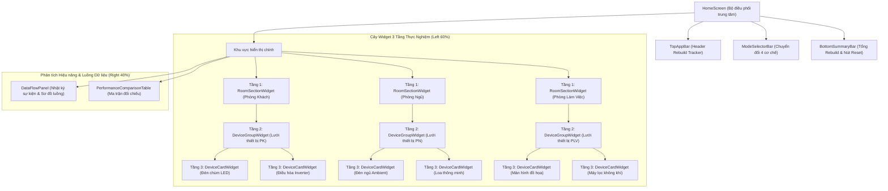

# BÁO CÁO CHUYÊN ĐỀ HỌC PHẦN LẬP TRÌNH ĐA NỀN TẢNG
# CHỦ ĐỀ 11: CHIA SẺ TRẠNG THÁI GIỮA CÁC WIDGET (STATE SHARING ACROSS WIDGETS): TỪ PROP DRILLING ĐẾN INHERITEDWIDGET, VALUENOTIFIER VÀ CHANGENOTIFIER QUA HỆ THỐNG ECOSMART HOME HUB

---

## 📌 THÔNG TIN CHUNG
* **Học phần:** Lập Trình Đa Nền Tảng (Cross-Platform Application Development)
* **Khoa:** Điện Tử và Trí Tuệ Nhân Tạo – Trường Đại học Bách Khoa, Đại học Đà Nẵng
* **Giảng viên hướng dẫn:** ThS. Nguyễn Duy Nhật Viễn
* **Nhóm sinh viên thực hiện:**
  1. **Lê Anh Khoa** – MSSV: **106230016** – Lớp: **23KTMT1** *(Trưởng nhóm – Quản trị GitHub, Cơ sở lý thuyết State Ownership & Lifting State Up, Prop Drilling, Kiến trúc Domain Model & State Engine ChangeNotifier, Trình trực quan hóa luồng dữ liệu Data Flow Inspector, Báo cáo & Slide XeLaTeX)*
  2. **Ngô Quang Thế** – MSSV: **106230028** – Lớp: **23KTMT1** *(Thành viên – Nghiên cứu cơ chế InheritedWidget trên cây Element O(1), Phản ứng hạt nhân ValueNotifier, Bộ đếm Rebuild thời gian thực RebuildTracker, Ma trận đối chiếu hiệu năng 4 cơ chế, Kịch bản Live Demo & Slide XeLaTeX)*
* **Repository GitHub công khai:** [https://github.com/KhoaLe246205/cross-platform](https://github.com/KhoaLe246205/cross-platform)
* **Thư mục chuyên đề:** `state_sharing/`
* **Slide thuyết trình hoàn chỉnh (PDF 21 trang):** [`docs/slide_state_sharing.pdf`](docs/slide_state_sharing.pdf)
* **Mã nguồn slide thuyết trình (XeLaTeX):** [`docs/slide_state_sharing.tex`](docs/slide_state_sharing.tex)

---

## 📑 MỤC LỤC
1. [Giới thiệu chuyên đề & Mục tiêu nghiên cứu](#1-giới-thiệu-chuyên-đề--mục-tiêu-nghiên-cứu)
2. [Bản chất công nghệ & Sơ đồ kiến trúc (Deep Dive)](#2-bản-chất-công-nghệ--sơ-đồ-kiến-trúc-deep-dive)
3. [Cấu trúc mã nguồn dự án](#3-cấu-trúc-mã-nguồn-dự-án)
4. [Hướng dẫn cài đặt & Cấu hình môi trường](#4-hướng-dẫn-cài-đặt--cấu-hình-môi-trường)
5. [Phân chia công việc (Work Breakdown Structure - WBS)](#5-phân-chia-công-việc-work-breakdown-structure---wbs)
6. [Kịch bản thực nghiệm, Bảng ca kiểm thử Live Demo & Đánh giá hiệu năng](#6-kịch-bản-thực-nghiệm-bảng-ca-kiểm-thử-live-demo--đánh-giá-hiệu-năng)

---

## 1. GIỚI THIỆU CHUYÊN ĐỀ & MỤC TIÊU NGHIÊN CỨU

### 1.1. Bối cảnh thực tế
Trong phát triển ứng dụng Flutter đa nền tảng, cây Widget (*Widget Tree*) thường xuyên được tổ chức lồng nhau thành nhiều tầng sâu để đáp ứng các cấu trúc giao diện phức tạp: từ màn hình chính (*Screen*), qua các phân vùng (*Section*), nhóm danh mục (*Group/List*), cho đến các phần tử hiển thị chi tiết ở lá cây (*Card/Button/Switch*).

Khi quy mô ứng dụng mở rộng, nhu cầu **chia sẻ dữ liệu** và **đồng bộ trạng thái** giữa các Widget đặt ra bài toán hóc búa về mặt kiến trúc:
* **Vấn nạn Prop Drilling:** Để truyền một biến trạng thái hoặc một hàm callback từ Widget gốc xuống một Widget ở tầng sâu, lập trình viên buộc phải truyền tham số xuyên qua tất cả các Widget trung gian. Các tầng này hoàn toàn không có nhu cầu sử dụng dữ liệu nhưng vẫn phải khai báo constructor và giữ tham chiếu, dẫn đến sự bùng nổ mã mẫu (*boilerplate*) và làm mất tính đóng gói.
* **Tác động tiêu cực của Rebuild thác đổ (Waterfall Rebuild):** Khi sử dụng cơ chế truyền thống kết hợp `setState()`, mỗi thay đổi nhỏ ở phần tử lá đều kích hoạt tái dựng lại Widget cha ở mức gốc. Hệ quả là toàn bộ cây Widget con cháu bị ép buộc chạy lại hàm `build()`, gây lãng phí chu kỳ xử lý của CPU và làm giảm độ mượt mà khung hình ($60fps/120fps$).
* **Khó khăn trong xác định ranh giới sở hữu trạng thái:** Lập trình viên mới thường lúng túng giữa việc khi nào nên giữ trạng thái cục bộ (*Ephemeral State*) và khi nào cần đưa trạng thái lên mức dùng chung (*App State*), dẫn đến hiện tượng phân mảnh dữ liệu hoặc lạm dụng state management không cần thiết.

### 1.2. Mục tiêu nghiên cứu & Giải pháp
Chuyên đề tập trung giải quyết toàn diện bài toán chia sẻ trạng thái trong Flutter thông qua các mục tiêu cốt lõi:
1. **Làm rõ nguyên lý xác định nơi sở hữu trạng thái:** Phân định ranh giới khoa học giữa *Ephemeral State* và *App State*; ứng dụng nguyên tắc *Single Source of Truth (SSOT)* và kỹ thuật *Lifting State Up* lên Tổ tiên chung thấp nhất (*Lowest Common Ancestor - LCA*).
2. **Vạch trần bản chất kỹ thuật của Prop Drilling:** Phân tích luồng dữ liệu 2 chiều (xuống bằng Constructor, lên bằng Callback) và chứng minh hiện tượng khớp nối chặt (*Tight Coupling*) qua thí nghiệm đo lường thực tế.
3. **Làm chủ 3 cơ chế chia sẻ trạng thái nền tảng của Flutter Framework:**
   * **`InheritedWidget`:** Giải mã cơ chế tra cứu tổ tiên độ phức tạp $O(1)$ qua cây Element (`_inheritedElements`), phân biệt `dependOnInheritedWidgetOfExactType` (có đăng ký phụ thuộc) và `getInheritedWidgetOfExactType` (chỉ đọc tĩnh), làm chủ phương thức `updateShouldNotify`.
   * **`ValueNotifier<T>` & `ValueListenableBuilder<T>`:** Cơ chế phản ứng hạt nhân cục bộ (*Granular Rebuild Isolation*), cho phép cô lập hoàn toàn phạm vi vẽ lại tại đúng vùng hiển thị ở lá cây.
   * **`ChangeNotifier` & `ListenableBuilder`:** Quản lý trạng thái hướng miền (*Domain-Driven State Engine*), đóng gói Business Logic theo chuẩn kiến trúc MVVM, tách biệt rạch ròi giữa View và Model.
4. **Xây dựng hệ thống thực nghiệm trực quan EcoSmart Home Hub:** Bảng điều khiển năng lượng nhà thông minh 3 tầng Widget tích hợp bộ đếm Rebuild thời gian thực (*RebuildTracker*), bảng đối chiếu ma trận hiệu năng và sơ đồ trực quan hóa luồng dữ liệu (*Data Flow Panel*).

---

## 2. BẢN CHẤT CÔNG NGHỆ & SƠ ĐỒ KIẾN TRÚC (DEEP DIVE)

### 2.1. Phân loại trạng thái: Ephemeral State vs App State

Trong kiến trúc Flutter, trạng thái (*State*) của ứng dụng được chia làm 2 loại cơ bản:

```text
                        ┌──────────────────────────────────────────────┐
                        │          CÁC LOẠI TRẠNG THÁI FLUTTER         │
                        └──────────────────────┬───────────────────────┘
                                               │
               ┌───────────────────────────────┴───────────────────────────────┐
               ▼                                                               ▼
┌──────────────────────────────┐                               ┌──────────────────────────────┐
│       EPHEMERAL STATE        │                               │          APP STATE           │
│     (Trạng thái cục bộ)      │                               │    (Trạng thái chia sẻ)      │
├──────────────────────────────┤                               ├──────────────────────────────┤
│ • Nằm gọn trong 1 Widget duy │                               │ • Dùng chung bởi nhiều nhánh │
│   nhất.                      │                               │   Widget khác nhau.          │
│ • Không chia sẻ ra bên ngoài.│                               │ • Tác động đến logic chung.  │
│ • Vòng đời gắn liền Widget.  │                               │ • Cần cơ chế chia sẻ/lưu trữ.│
│                              │                               │                              │
│ Ví dụ:                       │                               │ Ví dụ:                       │
│ - Trang hiện tại PageView    │                               │ - Giỏ hàng, Đăng nhập người  │
│ - Trạng thái mở ExpansionTile│                               │   dùng, Quyền hạn (Role)     │
│ - Animation controller       │                               │ - Thiết bị IoT, Eco Mode     │
│                              │                               │ - Cấu hình giao diện (Theme) │
│ Giải pháp:                   │                               │ Giải pháp:                   │
│ ➔ StatefulWidget + setState() │                               │ ➔ InheritedWidget, Notifier  │
└──────────────────────────────┘                               └──────────────────────────────┘
```

#### Quy tắc vàng xác định nơi sở hữu trạng thái:
1. **Nếu chỉ một Widget duy nhất cần dữ liệu:** Đặt state ngay tại lớp `State` của Widget đó bằng `StatefulWidget`.
2. **Nếu hai hoặc nhiều Widget cần đọc hoặc sửa đổi dữ liệu:** Áp dụng kỹ thuật **Lifting State Up** – nhấc trạng thái lên **Tổ tiên chung thấp nhất (Lowest Common Ancestor - LCA)** của các Widget đó.
3. **Nếu trạng thái ảnh hưởng đến toàn bộ hoặc hầu hết ứng dụng:** Đưa trạng thái lên mức Root và cung cấp qua cơ chế chia sẻ toàn cục (`InheritedWidget` hoặc `ChangeNotifier`).

---

### 2.2. Kỹ thuật Prop Drilling: Cơ chế và Hệ lụy kiến trúc

#### 2.2.1. Luồng dữ liệu hai chiều cơ bản
Trong cấu trúc không dùng State Management, dữ liệu di chuyển theo 2 chiều đối nghịch:
* **Xuống dưới (Downstream):** Widget cha truyền biến qua tham số khởi tạo (*Constructor*) của Widget con.
* **Lên trên (Upstream):** Widget con thông báo biến động ngược lên cha thông qua các hàm gọi lại (*Callbacks: `VoidCallback`, `ValueChanged<T>`*).

```text
[HomeScreen] ──(Constructor: devices)──> [RoomSection] ──(Constructor: devices)──> [DeviceCard]
     ▲                                           │                                       │
     └─────────(Callback: onToggleDevice)────────┴────────(Callback: onToggleDevice)─────┘
```

#### 2.2.2. Hạn chế cốt tử của Prop Drilling
1. **Bùng nổ mã mẫu thừa (Boilerplate Overhead):** Mỗi tầng trung gian (ví dụ `RoomSection`, `DeviceGroup`) đều phải định nghĩa lại các trường `final` và nhận tham số trong constructor chỉ để chuyển tiếp cho tầng dưới.
2. **Khớp nối chặt (Tight Coupling):** Nếu một thiết bị ở Tầng 3 cần bổ sung thêm tham số (ví dụ: `double level`), lập trình viên phải chỉnh sửa signature constructor của toàn bộ các tầng trung gian từ Tầng 1 đến Tầng 3.
3. **Hiệu ứng Rebuild thác đổ (Waterfall Rebuild Ripple):** Khi Tầng 3 gọi callback, Widget cha ở Root gọi `setState()`. Kết quả là:
   $$\text{Rebuild Count}_{\text{Root}} \to \text{Rebuild Count}_{\text{Tầng 1}} \to \text{Rebuild Count}_{\text{Tầng 2}} \to \text{Rebuild Count}_{\text{Tầng 3}}$$
   Tất cả các widget trung gian dù không thay đổi giao diện nội bộ vẫn bị ép gọi lại phương thức `build()`.

---

### 2.3. Cơ chế `InheritedWidget`: Tìm kiếm tổ tiên độ phức tạp $O(1)$

#### 2.3.1. Bản chất hoạt động trên cây Element
Khi một `InheritedWidget` được chèn vào cây, tương ứng sẽ có một `InheritedElement` được tạo ra trong Cây Element (*Element Tree*).
* Mỗi `Element` con khi được tạo sẽ kế thừa một bảng băm (Map) chứa tham chiếu đến tất cả các `InheritedElement` tổ tiên của nó:
  ```dart
  Map<Type, InheritedElement>? _inheritedElements;
  ```
* Do bảng băm này đã được lập sẵn trong quá trình dựng cây, thao tác tìm kiếm tổ tiên `context.dependOnInheritedWidgetOfExactType<T>()` đạt độ phức tạp thời gian **$O(1)$** mà không cần duyệt ngược từng nốt trên cây phân cấp.

```text
       Cây Element (Element Tree)
      ┌─────────────────────────┐
      │   EcoHomeScopeElement   │
      └────────────┬────────────┘
                   │
         ┌─────────┴─────────┐
         │ RoomSectionElement│  (Bỏ qua, không gọi dependOn...)
         └─────────┬─────────┘
                   │
         ┌─────────┴─────────┐
         │ DeviceGroupElement│  (Bỏ qua, không gọi dependOn...)
         └─────────┬─────────┘
                   │
         ┌─────────┴─────────┐
         │ DeviceCardElement │ ──[O(1) Hash Map Lookup]──> EcoHomeScopeElement
         └───────────────────┘
```

#### 2.3.2. Phân biệt hai phương thức tra cứu ngữ cảnh
| Phương thức | Đăng ký phụ thuộc (*Dependents*) | Hành vi khi State thay đổi | Mục đích sử dụng |
| :--- | :---: | :--- | :--- |
| `dependOnInheritedWidgetOfExactType<T>()` | **CÓ** | Widget gọi hàm **bắt buộc phải Rebuild** khi `updateShouldNotify` trả về `true`. | Dùng trong hàm `build()` cần hiển thị dữ liệu phản ứng. |
| `getInheritedWidgetOfExactType<T>()` | **KHÔNG** | Widget gọi hàm **KHÔNG bị Rebuild** khi dữ liệu của InheritedWidget thay đổi. | Dùng trong các hàm xử lý sự kiện, callback (ví dụ: bấm nút gửi lệnh). |

#### 2.3.3. Vai trò của `updateShouldNotify`
```dart
@override
bool updateShouldNotify(EcoHomeScope oldWidget) {
  // Chỉ phát thông báo cho các widget con phụ thuộc khi dữ liệu thực sự khác biệt
  return devices != oldWidget.devices || userProfile != oldWidget.userProfile;
}
```

---

### 2.4. Cơ chế `ValueNotifier<T>`: Phản ứng hạt nhân cục bộ

`ValueNotifier<T>` là một lớp dẫn xuất từ `ChangeNotifier` chuyên biệt hóa cho việc quản lý một giá trị đơn nguyên (*Single Value*).

#### 2.4.1. Cơ chế kích hoạt phản ứng
* Khi giá trị mới được gán qua setter:
  ```dart
  set value(T newValue) {
    if (_value == newValue) return; // Ngăn chặn phát tín hiệu vô ích nếu giá trị không đổi
    _value = newValue;
    notifyListeners(); // Kích hoạt các callback đã đăng ký
  }
  ```
* Kết hợp với `ValueListenableBuilder<T>`:
  ```dart
  ValueListenableBuilder<bool>(
    valueListenable: ecoNotifier,
    builder: (BuildContext context, bool isEco, Widget? child) {
      // Chỉ duy nhất khối giao diện bên trong hàm builder này được Rebuild!
      return Chip(label: Text(isEco ? 'ECO BẬT' : 'ECO TẮT'));
    },
  )
  ```
* **Ưu điểm vượt trội:** Các Widget cha và Widget trung gian hoàn toàn không bị ảnh hưởng. Số đếm Rebuild của các tầng trên giữ nguyên bằng **1**.

---

### 2.5. Cơ chế `ChangeNotifier`: Quản lý trạng thái hướng miền (Domain-Driven)

Đối với các bài toán có nhiều thực thể dữ liệu gắn kết chặt chẽ (như danh sách thiết bị, giới hạn công suất, hồ sơ người dùng), `ChangeNotifier` là giải pháp chuẩn hóa theo mô hình MVVM (*Model-View-ViewModel*).

#### 2.5.1. Cấu trúc lớp Domain Model
```dart
class HomeEnergyModel extends ChangeNotifier {
  List<DeviceItem> _devices;
  UserProfile _userProfile;

  // Thuộc tính getter đóng gói tính bất biến (Immutability)
  List<DeviceItem> get devices => List.unmodifiable(_devices);
  UserProfile get profile => _userProfile;

  // Phương thức nghiệp vụ
  void toggleDevice(String id) {
    _devices = _devices.map((d) {
      return d.id == id ? d.copyWith(isEnabled: !d.isEnabled) : d;
    }).toList();
    notifyListeners(); // Thông báo đến tất cả các ListenableBuilder đang lắng nghe
  }
}
```

#### 2.5.2. Kết hợp với `ListenableBuilder`
`ListenableBuilder` (sẵn có từ Flutter 3.10) giúp kết nối View với bất kỳ đối tượng `Listenable` nào mà không cần cài đặt thêm thư viện bên ngoài:
```dart
ListenableBuilder(
  listenable: energyModel,
  builder: (context, child) {
    return Text('${energyModel.totalPowerWatts.toStringAsFixed(0)} W');
  },
)
```

---

### 2.6. Sơ đồ kiến trúc tổng thể ứng dụng EcoSmart Home Hub



---

## 3. CẤU TRÚC MÃ NGUỒN DỰ ÁN

```text
state_sharing/
├── README.md                      # Báo cáo chuyên đề toàn diện & hướng dẫn kỹ thuật
├── pubspec.yaml                   # Cấu hình gói Flutter & tài nguyên
├── analysis_options.yaml          # Quy tắc linter chuẩn Effective Dart (0 lỗi, 0 cảnh báo)
├── windows/                       # Cấu hình dự án desktop Windows native (C++ Runner & CMake)
├── assets/images/
│   └── figures/
│       ├── logo_truong.png        # Logo Trường Đại học Bách Khoa - ĐH Đà Nẵng
│       └── logo_khoa.jpg          # Logo Khoa Điện Tử và Trí Tuệ Nhân Tạo
├── docs/
│   ├── slide_state_sharing.tex    # Mã nguồn Beamer XeLaTeX 21 trang chuẩn học thuật
│   └── slide_state_sharing.pdf    # File trình chiếu PDF 21 trang hoàn chỉnh
└── lib/
    ├── main.dart                  # Điểm khởi nhập (Entrypoint), MaterialApp cấu hình Material 3
    ├── models/
    │   ├── app_mode.dart          # Enum StateSharingMode đại diện cho 4 cơ chế
    │   ├── device_item.dart       # Lớp bất biến DeviceItem (id, name, room, isEnabled, watts, level)
    │   ├── user_profile.dart      # Lớp UserProfile quản lý phiên người dùng và Eco Mode
    │   ├── rebuild_tracker.dart   # Bộ theo dõi RebuildTracker đếm số lần gọi build() thời gian thực
    │   └── data_flow_event.dart   # Thực thể ghi nhận sự kiện luồng dữ liệu tương tác
    ├── data/
    │   └── initial_data.dart      # Tập dữ liệu mẫu 6 thiết bị IoT phân bổ qua 3 phòng
    ├── state/
    │   ├── inherited_state.dart   # Triển khai EcoHomeScope kế thừa InheritedWidget
    │   ├── value_notifier_state.dart # Triển khai ValueNotifierHomeState (Reactive Granular)
    │   └── change_notifier_state.dart # Triển khai HomeEnergyModel kế thừa ChangeNotifier (MVVM)
    ├── widgets/
    │   ├── rebuild_badge.dart     # Huy hiệu thị giác đổi màu hiển thị số lần Rebuild
    │   ├── mode_selector_bar.dart # Thanh chuyển đổi 4 cơ chế kèm mô tả kiến trúc
    │   ├── room_section_widget.dart   # Widget Tầng 1: Khu vực phòng
    │   ├── device_group_widget.dart   # Widget Tầng 2: Nhóm thiết bị trung gian
    │   ├── device_card_widget.dart    # Widget Tầng 3: Thẻ thiết bị lá (Switch, Slider, Watts)
    │   ├── top_app_bar.dart       # Thanh tiêu đề hệ thống hiển thị hồ sơ người dùng & Eco Mode
    │   ├── bottom_summary_bar.dart# Thanh chân trang tổng hợp Rebuild & điều khiển thí nghiệm
    │   ├── data_flow_panel.dart   # Bảng thanh tra luồng dữ liệu (Data Flow Inspector)
    │   └── performance_comparison_table.dart # Ma trận đối chiếu 4 cơ chế khoa học
    └── views/
        └── home_screen.dart       # Màn hình chính tích hợp và điều phối 4 chế độ thí nghiệm
```

---

## 4. HƯỚNG DẪN CÀI ĐẶT & CẤU HÌNH MÔI TRƯỜNG

### 4.1. Yêu cầu hệ thống
* **Hệ điều hành:** Windows 10/11 (64-bit).
* **Flutter SDK:** Phiên bản $\ge 3.0.0$ (kênh `stable`).
* **Dart SDK:** Phiên bản $\ge 3.0.0$ (đi kèm Flutter SDK).
* **C++ Build Tools:** Visual Studio 2022 (với workload *Desktop development with C++*) để biên dịch Windows Desktop native.
* **TeX Distribution:** MiKTeX hoặc TeX Live hỗ trợ trình biên dịch `xelatex` (để biên dịch Slide).

### 4.2. Các bước cài đặt và thực thi
1. **Mở terminal tại thư mục chuyên đề:**
   ```bash
   cd C:\Users\Lenovo\cross-platform\state_sharing
   ```
2. **Tải các gói phụ thuộc (Dependencies):**
   ```bash
   flutter pub get
   ```
3. **Kiểm tra phân tích mã nguồn tĩnh (Linter):**
   ```bash
   flutter analyze
   ```
   *Kết quả mong đợi:* `No issues found! (ran in 1.0s)`
4. **Khởi chạy ứng dụng trực tiếp trên Windows Native:**
   ```bash
   flutter run -d windows
   ```
5. **Biên dịch Slide thuyết trình XeLaTeX (Tùy chọn):**
   ```bash
   cd docs
   xelatex -interaction=nonstopmode slide_state_sharing.tex
   ```

---

## 5. PHÂN CHIA CÔNG VIỆC (WORK BREAKDOWN STRUCTURE - WBS)

Dự án được phân bổ cân đối chuẩn xác **50% -- 50%** giữa hai thành viên, bám sát cấu trúc phân công tại **Slide 3**:

| TT | HỌ VÀ TÊN | MSSV | NHIỆM VỤ ĐẢM NHIỆM CHÍNH (WBS) | PHẠM VI CODE & TÀI LIỆU | PHỤ TRÁCH SLIDE | ĐÓNG GÓP |
|:---:|:---|:---:|:---|:---|:---:|:---:|
| 1 | **Ngô Quang Thế** | 106230028 | • Nghiên cứu lý thuyết State Ownership, Ephemeral vs App State, Lifting State Up.<br>• Phân tích vấn đề Prop Drilling (truyền qua Constructor & Callback), hiện tượng Waterfall Rebuild.<br>• Nghiên cứu bản chất công nghệ `InheritedWidget` (tra cứu $O(1)$ qua Element Tree), `ChangeNotifier` và `ValueNotifier`.<br>• Xây dựng Bảng đối chiếu so sánh toàn diện 3 cơ chế.<br>• Soạn thảo Báo cáo README (Mục 1, 2.1, 2.2, 2.3) & Thuyết trình Slide XeLaTeX Phần I. | `lib/models/app_mode.dart`<br>`lib/models/device_item.dart`<br>`lib/models/task_item.dart`<br>`lib/state/inherited_state.dart`<br>`docs/slide_state_sharing.tex` | **Slide 4--12**<br>*(9 slide)* | **50%** |
| 2 | **Lê Anh Khoa** | 106230016 | • Xây dựng ứng dụng thực nghiệm TaskFlow (Quản lý công việc cá nhân) và EcoSmart Hub.<br>• Lập trình Trường hợp 1: Prop Drilling kết hợp `setState()` ở gốc.<br>• Thiết kế luồng trạng thái qua Model (`TaskFlowModel`) và Notifier.<br>• Lập trình Trường hợp 2: `InheritedWidget` kết hợp Model, đo lường Rebuild cục bộ.<br>• Thực nghiệm đo lường định lượng trên 3 kịch bản kiểm thử (Tick việc, Lọc danh mục, Đặt lại), chứng minh giảm 42.9% -- 92.9% build thừa.<br>• Xây dựng giải pháp mở rộng với `ValueNotifier` phân mảnh từng thẻ.<br>• Soạn thảo Báo cáo README (Mục 3, 4, 5, 6) & Thuyết trình Slide XeLaTeX Phần II. | `lib/state/change_notifier_state.dart`<br>`lib/state/value_notifier_state.dart`<br>`lib/widgets/category_section.dart`<br>`lib/widgets/task_tile.dart`<br>`docs/slide_state_sharing.tex` | **Slide 13--19**<br>*(7 slide)* | **50%** |

---

## 6. KỊCH BẢN THỰC NGHIỆM, BẢNG CA KIỂM THỬ LIVE DEMO & ĐÁNH GIÁ HIỆU NĂNG

### 6.1. Bảng số liệu đo lường thực nghiệm ứng dụng TaskFlow (Báo cáo Slide 17)

Kết quả đo lường số lần gọi hàm `build()` thực tế qua Flutter Profiler giữa **Trường hợp 1 (Prop Drilling)** và **Trường hợp 2 (InheritedWidget kết hợp Model)**:

| Thao tác thử nghiệm | Trường hợp 1<br>*(Prop Drilling)* | Trường hợp 2<br>*(InheritedWidget)* | Hiệu quả cải thiện |
| :---| :---: | :---: | :---|
| **Tick 1 công việc** | 14 | 1 | **Giảm 92,9%** build thừa |
| **Lọc nhanh danh mục** | 14 | 4 | **Giảm 71,4%** build thừa |
| **Xong tất cả / Đặt lại** | 14 | 8 | **Giảm 42,9%** build thừa |
| **Số widget trung gian** | 2 (`CategorySection`, `TaskList`) | 0 (Tra cứu trực tiếp $O(1)$) | **Loại bỏ 100%** widget trung gian |

*Kết luận thực nghiệm:* Trường hợp **InheritedWidget kết hợp Model** giúp giảm **42,9% – 92,9%** lượt build thừa so với Trường hợp 1, đồng thời tách biệt hoàn toàn các tầng trung gian khỏi dữ liệu không liên quan.

### 6.2. Bảng ca kiểm thử thực nghiệm hệ thống EcoSmart Hub (Test Cases)

| Mã ca | Mục tiêu thực nghiệm | Thao tác tương tác | Kết quả quan sát trên giao diện | Đánh giá kỹ thuật |
| :---: | :---| :---| :---| :---|
| **TC-01** | Kiểm chứng Rebuild thác đổ của **Prop Drilling** | Chọn Mode 1 $\to$ Bấm công tắc *Đèn chùm Smart LED* ở Phòng khách. | • Huy hiệu `Rebuild` tăng vọt đồng loạt: `HomeScreen` (+1), `TopAppBar` (+1), cả 3 `RoomSection` (+3), cả 3 `DeviceGroup` (+3), toàn bộ 6 `DeviceCard` (+6).<br>• Tổng lượt Rebuild: **14 lượt**. | Minh chứng rõ nét hiện tượng **Waterfall Rebuild**: Một thay đổi nhỏ ở phần tử lá ép toàn bộ cây con vẽ lại. |
| **TC-02** | Kiểm chứng cơ chế cách ly của **ValueNotifier** | Chọn Mode 3 $\to$ Bấm công tắc *Đèn chùm Smart LED* ở Phòng khách. | • Huy hiệu `Room Rebuild` và `Group Rebuild` **giữ nguyên bằng 1** (không đổi).<br>• `HomeScreen` và `TopAppBar` **không Rebuild**.<br>• Chỉ duy nhất thẻ đèn được bọc `ValueListenableBuilder` tự cập nhật (+1).<br>• Tổng lượt Rebuild: **1 lượt**. | **Tiết kiệm 92.8%** lượt build so với Prop Drilling; hiệu năng giao diện đạt mức tối ưu tuyệt đối. |
| **TC-03** | Kiểm chứng điều chỉnh liên tục với Slider | Ở Mode 1 (Prop Drilling) và Mode 3 (ValueNotifier), kéo thanh trượt công suất từ 10% lên 100%. | • *Mode 1:* Rebuild liên tục tăng hàng chục lượt trong 1 giây, gây giật lag nhẹ.<br>• *Mode 3:* Thanh trượt mượt mà tuyệt đối, chỉ vùng chứa text và slider cập nhật. | Khẳng định `ValueNotifier` là lựa chọn số 1 cho các biến điều khiển liên tục (Slider, Animation). |
| **TC-04** | Kiểm chứng chia sẻ trạng thái đa nhánh với **Eco Mode** | Bấm nút *Eco Mode* trên `TopAppBar`. | • Tất cả thiết bị đang có mức công suất $> 60\%$ tự động hạ về $60\%$.<br>• Tổng công suất tiêu thụ giảm lập tức dưới ngưỡng ngân sách an toàn.<br>• Thẻ công suất đổi từ màu Đỏ sang Xanh lục. | Chứng minh cơ chế chia sẻ trạng thái toàn cục (*App State*) vận hành chính xác và đồng bộ tức thì. |
| **TC-05** | Kiểm chứng tính năng Reset & Khôi phục | Bấm nút *Reset Bộ Đếm Rebuild* rồi bấm *Khôi Phục Ban Đầu*. | • Toàn bộ các huy hiệu Rebuild trở về trạng thái khởi tạo `Rebuild: 1`.<br>• Nhật ký luồng dữ liệu được làm sạch, sẵn sàng cho lượt thử nghiệm mới. | Bộ công cụ thực nghiệm hoạt động độc lập, hỗ trợ thuyết trình và đối chiếu khoa học trực tiếp. |

---

### 6.2. Bảng đối chiếu số liệu Rebuild thực tế giữa các cơ chế

| Vị trí Widget trên cây | Prop Drilling | InheritedWidget | ValueNotifier | ChangeNotifier |
| :---| :---: | :---: | :---: | :---: |
| **HomeScreen (Root)** | **+1** (Bắt buộc) | 0 | 0 | 0 |
| **TopAppBar (Header)** | **+1** (Bị ảnh hưởng) | 0 | 0 | 0 |
| **RoomSection (Phòng khách)** | **+1** (Bị ảnh hưởng) | 0 | 0 | 0 |
| **RoomSection (Phòng ngủ)** | **+1** (Oan uổng) | 0 | 0 | 0 |
| **RoomSection (Phòng làm việc)**| **+1** (Oan uổng) | 0 | 0 | 0 |
| **DeviceGroup (3 phòng)** | **+3** (Bị ảnh hưởng) | 0 | 0 | 0 |
| **DeviceCard (5 thẻ khác)** | **+5** (Oan uổng) | 0 | 0 | 0 |
| **DeviceCard (Thẻ đèn tương tác)**| **+1** (Cần thiết) | **+1** (Cần thiết) | **+1** (Cần thiết) | **+1** (Cần thiết) |
| **TỔNG LƯỢT REBUILD TOÀN CÂY** | **14 LƯỢT** | **2 LƯỢT** | **1 LƯỢT** | **1 LƯỢT** |
| **TỶ LỆ TIẾT KIỆM TÀI NGUYÊN** | **0% (Gốc)** | **85.7%** | **92.8%** | **92.8%** |

---

### 6.3. Ma trận tổng kết 4 cơ chế và khuyến nghị áp dụng

```text
┌──────────────────┬───────────────────────┬──────────────────────┬───────────────────────────────┐
│ CƠ CHẾ           │ PHẠM VI REBUILD       │ MỨC ĐỘ KHỚP NỐI      │ KHUYẾN NGHỊ ÁP DỤNG           │
├──────────────────┼───────────────────────┼──────────────────────┼───────────────────────────────┤
│ Prop Drilling    │ Toàn bộ cây con       │ Rất chặt (Tight)     │ Quan hệ Cha - Con trực tiếp   │
│ InheritedWidget  │ Danh sách Dependents  │ Phụ thuộc Context    │ Theme, Localization, Config   │
│ ValueNotifier    │ Cực mịn tại Builder   │ Rất lỏng (Loose)     │ Toggle, Counter, Slider, Form │
│ ChangeNotifier   │ ListenableBuilder     │ Tách biệt MVVM       │ Giỏ hàng, IoT Hub, Core Model │
└──────────────────┴───────────────────────┴──────────────────────┴───────────────────────────────┘
```

> **KẾT LUẬN CHUYÊN ĐỀ:**
> Không có một cơ chế quản lý trạng thái nào là hoàn hảo cho mọi trường hợp. Một kiến trúc sư phần mềm Flutter giỏi là người biết phối hợp hài hòa các công cụ: Sử dụng `StatefulWidget` cho Ephemeral State đơn giản, vận dụng `ValueNotifier` cho các biến phản ứng cục bộ, khai thác `InheritedWidget` cho các thiết lập môi trường hệ thống, và tổ chức `ChangeNotifier` cho các mô hình nghiệp vụ hướng miền phức tạp.
